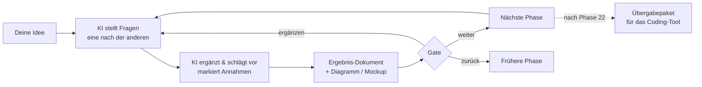

# idea-to-app 💡→📱

**Von der App-Idee zum sicheren Bauplan – Schritt für Schritt, geführt von einer KI.**

Du erzählst deine Idee. Die KI stellt dir Fragen – immer nur eine auf einmal –, ergänzt fehlende Punkte, zeichnet Abläufe und Mockups und fragt nach jedem Schritt: **Weiter oder noch etwas ergänzen?** Am Ende steht ein vollständiger Bauplan, den ein KI-Coding-Tool (Claude Code, Cursor, Copilot …) direkt und sicher umsetzen kann.

Gemacht für **Einsteiger ohne Programmiererfahrung** – Entwickler können sich genauso bedienen (Entwickler-Modus, Sicherheitsreferenz, Vorlagen).

> idea-to-app ist kein Programm, sondern eine Sammlung von Anleitungen in Markdown, die eine KI liest und befolgt. Es funktioniert mit jedem guten KI-Tool.

---

## So funktioniert es



Nach jeder Phase siehst du so einen Block:

```
──────────────────────────────
✅ Phase 6 – User-Flows: Entwurf fertig
📄 Ergebnis: projekte/meine-app/06-flows.md
🖼️ Visual: 4 Flussdiagramme
💡 Meine Annahmen: Offline nur lesend
❓ Noch offen: nichts

Wie möchtest du weitermachen?
1️⃣ Weiter zu Phase 7 – Screens & Navigation
2️⃣ Etwas ergänzen oder ändern
3️⃣ Zurück zu einer früheren Phase
4️⃣ Pause – alles ist gespeichert
──────────────────────────────
```

## Schnellstart

| Du nutzt … | So startest du |
|---|---|
| **Claude Code** | Repository klonen, im Ordner `claude` starten, schreiben: *„Ich habe eine App-Idee“* oder `/idea-to-app` |
| **Cursor / VS Code + Copilot / Codex / Gemini CLI** | Ordner öffnen, Agent-Modus, schreiben: *„Lies AGENTS.md und starte mit Phase 0.“* |
| **Claude.ai / ChatGPT / Gemini (Chat)** | Dateien als Projektwissen hinzufügen und den Text aus [`START.md`](START.md) einfügen |

Ausführlich: [`guides/tools.md`](guides/tools.md) · Ganz ohne Vorwissen: [`guides/einsteiger-start.md`](guides/einsteiger-start.md)

**Tipp:** Über **„Use this template“** oben auf GitHub legst du dir eine eigene (gern private) Kopie an. Dann landen deine Projektdateien in deinem eigenen Repository.

## Die 25 Phasen

| # | Phase | Was passiert | Visual | Lite |
|---|---|---|---|---|
| 0 | [Start & Modus](phases/00-start-und-modus.md) | Erfahrung, Voll/Lite, Plattform, **Risikostufe** | – | ✅ |
| 1 | [Idee & Problem](phases/01-idee-und-problem.md) | Problem vs. Lösung, Ein-Satz-Pitch, ehrliche Schwachstelle | – | ✅ |
| 2 | [Idee validieren](phases/02-idee-validieren.md) | Riskanteste Annahme, günstiger Test, Abbruchkriterium | Annahmen-Tabelle | |
| 3 | [Zielgruppe](phases/03-zielgruppe.md) | Personas, Nutzungssituation, Rollen | Persona-Karten | ✅ |
| 4 | [Markt & Wettbewerb](phases/04-markt-und-wettbewerb.md) | Alternativen, Differenzierung, Namens-/Markencheck | Vergleichstabelle | |
| 5 | [MVP-Umfang](phases/05-mvp-scope.md) | Muss/Sollte/Später/Nie, User Stories | Nutzen-Aufwand-Matrix | ✅ |
| 6 | [User-Flows](phases/06-user-flows.md) | Abläufe inkl. Leer-, Fehler-, Offline- und Missbrauchsfällen | Flussdiagramme | ✅ |
| 7 | [Screens & Navigation](phases/07-screens-und-navigation.md) | Screen-Liste, Navigation, Sichtbarkeit | Screen-Map | |
| 8 | [Mockups](phases/08-mockups.md) | Klickbare Lo-fi-Wireframes, Varianten zur Wahl | HTML-Wireframes | ✅ |
| 9 | [Design-System](phases/09-design-system.md) | Farben, Schrift, Komponenten, Kontrastprüfung | Style-Tile | |
| 10 | [Barrierefreiheit & Sprachen](phases/10-barrierefreiheit-und-sprachen.md) | WCAG-Basis, BFSG-Einordnung, Mehrsprachigkeit | Checkliste | |
| 11 | [Daten & Inhalte](phases/11-daten-und-inhalte.md) | Datenmodell, **Datenklassifizierung**, Löschfristen | ER-Diagramm | ✅ |
| 12 | [Rollen & Berechtigungen](phases/12-rollen-und-berechtigungen.md) | **Wer darf was** – Grundlage gegen „ID in der URL ändern“ | Berechtigungsmatrix | vor Launch |
| 13 | [Tech-Stack & Architektur](phases/13-tech-stack-und-architektur.md) | Begründete Technikwahl, Umgebungen, Vertrauensgrenzen | Architektur-Diagramm | ✅ |
| 14 | [Sicherheitsarchitektur](phases/14-sicherheitsarchitektur.md) | Passwörter, Sitzungen, Zugriffskontrolle, Secrets, Rate Limiting, Eingaben, Header … | Bedrohungsmodell | ✅ |
| 15 | [Login, Zahlung, Integrationen](phases/15-auth-zahlung-integrationen.md) | Anbieterwahl, Datenflüsse, sichere Zahlungsfreischaltung | Sequenzdiagramme | |
| 16 | [Recht & Datenschutz](phases/16-recht-und-datenschutz.md) | DSGVO, Impressum, Einwilligungen, Export/Löschung, AVV | Verarbeitungsverzeichnis | vor Launch |
| 17 | [Monetarisierung & Kosten](phases/17-monetarisierung-und-kosten.md) | Preismodell, Betriebskosten, **harte Kostenlimits** | Kostenszenarien | |
| 18 | [Performance, Offline, Benachrichtigungen](phases/18-nicht-funktionale-anforderungen.md) | Messbare Qualitätsziele | Zielwerte | |
| 19 | [Qualität & Tests](phases/19-qualitaet-und-tests.md) | Akzeptanzkriterien, **automatisierte Sicherheitstests** | Testmatrix | vor Launch |
| 20 | [Betrieb](phases/20-betrieb.md) | Deployment, Monitoring, Backups, Notfallplan | Deployment-Ablauf | vor Launch |
| 21 | [Roadmap & Aufgaben](phases/21-roadmap-und-tasks.md) | Meilensteine, kleine prüfbare Aufgaben | Roadmap | ✅ |
| 22 | [Build-Handoff](phases/22-build-handoff.md) | Übergabepaket + Start-Prompt für das Coding-Tool | – | ✅ |
| 23 | [Launch](phases/23-launch.md) | Launch-Checkliste, App-Store-Anforderungen | Checkliste | vor Launch |
| 24 | [Iteration & Wartung](phases/24-iteration-und-wartung.md) | Feedback-Kreislauf, Wartungsroutine | Kreislauf | |

**Lite-Modus** (schneller Prototyp): 11 Kernphasen. Bevor die App für andere Menschen veröffentlicht wird, kommen die mit „vor Launch“ markierten Phasen dazu.

## Sicherheit von Anfang an

KI-Coding-Tools bauen schnell – und vergessen dabei gern die Grundregeln. idea-to-app verankert Sicherheit an drei Stellen:

1. **Früh geplant:** Datenklassifizierung (Phase 11), Berechtigungsmatrix (Phase 12), Sicherheitskonzept (Phase 14) – abgestuft nach Risikostufe 1–3.
2. **Verbindlich übergeben:** [Nicht verhandelbare Regeln](security/regeln-fuer-ki.md) landen wörtlich in der `AGENTS.md` deines App-Repositories.
3. **Automatisch geprüft:** [Sicherheitstests](security/sicherheitstests.md) und [Launch-Checkliste](security/checkliste.md).

Abgedeckt sind u. a.:
- **Passwort-Hashing** mit Argon2id/bcrypt – bzw. erprobte Login-Anbieter statt Eigenbau
- **Keine geheimen API-Schlüssel im Frontend** – Unterscheidung öffentlicher und geheimer Schlüssel
- **Kein Zugriff auf fremde Daten durch geänderte IDs in der URL** (IDOR/BOLA) – serverseitige Besitzprüfung + Datenbankregeln (z. B. Row Level Security) + Tests
- **Automatischer Schutz gegen zu viele Anfragen und Login-Versuche** – Rate Limiting pro Konto und IP, steigende Wartezeiten statt dauerhafter Sperre, CAPTCHA, Kostenlimits gegen „Denial of Wallet“
- Mass Assignment, Nutzer-Enumeration, sichere Passwort-Resets, Sitzungen, CSRF, XSS, SQL-Injection, sichere Uploads, Security-Header/CSP, CORS, Webhook-Signaturen, KI-Funktionen (Prompt-Injection), Abhängigkeiten, Logging, Backups, Notfallplan

> **Ehrlicher Hinweis:** Ein guter Plan macht eine App nicht automatisch sicher. Er sorgt dafür, dass die richtigen Regeln gelten und geprüft werden. Für Apps mit sensiblen Daten (Gesundheit, Finanzen, Kinder) ist eine Prüfung durch Fachleute vor dem Start dringend empfohlen.

## Was am Ende herauskommt

```
projekte/meine-app/
├── PROJECT_STATE.md          ← Stand, Annahmen, offene Fragen, Parkplatz
├── ENTSCHEIDUNGEN.md         ← jede Entscheidung mit Begründung
├── 00-start.md … 24-iteration.md
├── mockups/                  ← klickbare HTML-Wireframes, Style-Tile
└── handoff/                  ← in dein neues App-Repository kopieren
    ├── AGENTS.md             ← Regeln + Sicherheitsregeln für das Coding-Tool
    ├── CLAUDE.md
    ├── START-PROMPT.md       ← erste Nachricht an das Coding-Tool
    └── docs/                 ← Produkt, Flows, Design, Daten, Sicherheit, Tests, Roadmap …
```

## Aufbau des Repositories

| Pfad | Inhalt |
|---|---|
| [`AGENTS.md`](AGENTS.md) | Steuerdatei für die KI: Rolle, Regeln, Gate, Befehle, Modi, Abhängigkeiten |
| [`phases/`](phases/) | Die 25 Phasen |
| [`security/`](security/) | Sicherheitsregeln, Bedrohungsmodell, Checkliste, Tests, Stack-Hinweise |
| [`templates/`](templates/) | Projektstatus, Entscheidungs-Log, Wireframe, Style-Tile, Handoff, Start-Prompt |
| [`guides/`](guides/) | Einsteiger-Guide, Tool-Guide, Glossar |
| [`examples/`](examples/) | Beispiel-Dialog |
| [`START.md`](START.md) | Start-Text für Chat-KIs |
| `CLAUDE.md`, `GEMINI.md`, `.claude/`, `.cursor/`, `.github/` | Anbindung an die jeweiligen Tools |

## Befehle während des Durchlaufs

`weiter` · `erklär das` · `entscheide du` · `parkplatz: …` · `status` · `zusammenfassung` · `zurück zu Phase N` · `überspringen` · `pause`

## Grenzen

- **Keine Rechtsberatung.** Phase 16 zeigt übliche Pflichten (Deutschland/EU) und bereitet Entwürfe vor – bei Geschäftsideen oder sensiblen Daten Fachberatung einholen.
- **Keine Sicherheitsgarantie.** Siehe oben.
- **Preise, Anbieterbedingungen und Store-Richtlinien ändern sich.** Die KI ist angewiesen, nichts zu erfinden und auf Prüfung hinzuweisen.
- Die Qualität hängt vom genutzten KI-Modell ab. Starke Modelle halten sich zuverlässiger an „eine Frage pro Nachricht“ und das Gate.

## Inspiration

Die Idee steht auf den Schultern bestehender Ansätze für spec-getriebene KI-Entwicklung, u. a. GitHub Spec Kit, OpenSpec, BMAD-Method und der Brainstorming-Skill aus obra/superpowers (eine Frage nach der anderen, Freigabe vor dem Weitermachen). idea-to-app übernimmt keinen Code daraus, sondern verbindet das Prinzip mit einem durchgehenden, einsteigerfreundlichen Ablauf, Mockups und Sicherheit von Anfang an.

## Lizenz

[MIT](LICENSE) · Beiträge willkommen: [`CONTRIBUTING.md`](CONTRIBUTING.md)
