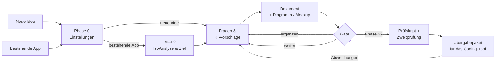

# idea-to-app 💡→📱

**Von der App-Idee – oder einer bestehenden App – zum sicheren Bauplan. Schritt für Schritt, geführt von einer KI.**

Du erzählst deine Idee oder zeigst deine App. Die KI stellt dir Fragen, ergänzt fehlende Punkte, zeichnet Abläufe und Mockups und fragt nach jedem Schritt: **Weiter oder noch etwas ergänzen?** Am Ende steht ein vollständiger, **geprüfter** Bauplan, den ein KI-Coding-Tool (Claude Code, Cursor, Copilot …) direkt und sicher umsetzen kann.

Gemacht für **Einsteiger ohne Programmiererfahrung** – Entwickler können sich genauso bedienen (adaptiver Modus, Sicherheitsreferenz, Prüfskript, Vorlagen).

> idea-to-app ist kein App-Baukasten, sondern ein Regelwerk in Markdown, das eine KI liest und befolgt – plus ein kleines Prüfskript. Es funktioniert mit jedem guten KI-Tool.

---

## So funktioniert es



Nach jeder Phase siehst du so einen Block:

```
──────────────────────────────
✅ Phase 6 – User-Flows: Entwurf fertig
📄 Ergebnis: projekte/meine-app/06-flows.md
🖼️ Visual: 4 Flussdiagramme
💡 Meine Annahmen: A-007 Offline nur lesend
❓ Noch offen: nichts
📊 Fortschritt: ▓▓▓▓▓░░░░░ 6 von 11 Phasen

Wie möchtest du weitermachen?
1️⃣ Weiter zu Phase 8 – Mockups
2️⃣ Etwas ergänzen oder ändern
3️⃣ Zurück zu einer früheren Phase
4️⃣ Pause – alles ist gespeichert
──────────────────────────────
```

## Schnellstart

| Du nutzt … | So startest du |
|---|---|
| **Claude Code** | Repository klonen, im Ordner `claude` starten, schreiben: *„Ich habe eine App-Idee“* oder `/idea-to-app` |
| **Cursor / VS Code + Copilot / Codex / Gemini CLI** | Ordner öffnen, Agent-Modus, schreiben: *„Lies AGENTS.md und starte mit Phase 0.“* |
| **Claude.ai / ChatGPT / Gemini (Chat)** | Dateien als Projektwissen hinzufügen und den Text aus [`START.md`](START.md) einfügen |

Ausführlich: [`guides/tools.md`](guides/tools.md) · Ganz ohne Vorwissen: [`guides/einsteiger-start.md`](guides/einsteiger-start.md)

**Tipp:** Über **„Use this template“** oben auf GitHub legst du dir eine eigene (gern private) Kopie an. Dann landen deine Projektdateien in deinem eigenen Repository.

## Einstellungen

| | Optionen | Wofür |
|---|---|---|
| **Einstieg** | Neue Idee · **Bestehende App** | Bestehende App: zuerst [Ist-Analyse](modes/bestehende-app.md) des Codes (nur lesend), Befunde mit Schweregrad, dann nur die Phasen, die das Ziel braucht – weiterentwickeln, sanieren, prüfen oder verstehen |
| **Arbeitsweise** | **Geführt** · [Adaptiv](modes/adaptiv.md) | Geführt: eine Frage nach der anderen, Freigabe jeder Phase (Standard für Einsteiger). Adaptiv: KI füllt Bekanntes selbst aus, fragt nur bei kritischen Entscheidungen, Freigabe in 5 Blöcken |
| **Umfang** | Voll · Lite | Lite: 11 Kernphasen für einen schnellen Prototyp |
| **Risikostufe** | 1 · 2 · 3 | Bestimmt die Tiefe von Sicherheit und Recht (z. B. Konten → 2, Gesundheitsdaten → 3) |

## Die 25 Phasen

| # | Phase | Was passiert | Visual | Lite |
|---|---|---|---|---|
| 0 | [Start & Einstellungen](phases/00-start-und-modus.md) | Einstieg, Arbeitsweise, Umfang, Plattform, **Risikostufe** | – | ✅ |
| 1 | [Idee & Problem](phases/01-idee-und-problem.md) | Problem vs. Lösung, Ein-Satz-Pitch, ehrliche Schwachstelle | – | ✅ |
| 2 | [Idee validieren](phases/02-idee-validieren.md) | Riskanteste Annahme, günstiger Test, Abbruchkriterium | Annahmen-Tabelle | |
| 3 | [Zielgruppe](phases/03-zielgruppe.md) | Personas, Nutzungssituation, Rollen | Persona-Karten | ✅ |
| 4 | [Markt & Wettbewerb](phases/04-markt-und-wettbewerb.md) | Alternativen mit Quellen, Differenzierung, Namens-/Markencheck | Vergleichstabelle | |
| 5 | [MVP-Umfang](phases/05-mvp-scope.md) | Funktionen mit IDs, Muss/Sollte/Später/Nie, User Stories | Nutzen-Aufwand-Matrix | ✅ |
| 6 | [User-Flows](phases/06-user-flows.md) | Abläufe inkl. Leer-, Fehler-, Offline- und Missbrauchsfällen | Flussdiagramme | ✅ |
| 7 | [Screens & Navigation](phases/07-screens-und-navigation.md) | Screen-Liste, Navigation, Sichtbarkeit | Screen-Map | |
| 8 | [Mockups](phases/08-mockups.md) | Klickbare Wireframes, 2–3 echte Gestaltungsrichtungen zur Wahl | HTML-Wireframes | ✅ |
| 9 | [Design-System](phases/09-design-system.md) | Farben, Schrift, Komponenten, Kontrastprüfung | Style-Tile | |
| 10 | [Barrierefreiheit & Sprachen](phases/10-barrierefreiheit-und-sprachen.md) | WCAG-Basis, BFSG-Einordnung, Mehrsprachigkeit | Checkliste | |
| 11 | [Daten & Inhalte](phases/11-daten-und-inhalte.md) | Datenmodell, **Datenklassifizierung**, Löschfristen | ER-Diagramm | ✅ |
| 12 | [Rollen & Berechtigungen](phases/12-rollen-und-berechtigungen.md) | **Wer darf was** – Grundlage gegen „ID in der URL ändern“ | Berechtigungsmatrix | vor Launch |
| 13 | [Tech-Stack & Architektur](phases/13-tech-stack-und-architektur.md) | 2–3 Optionen in einer Bewertungsmatrix, Umgebungen, Vertrauensgrenzen | Architektur-Diagramm | ✅ |
| 14 | [Sicherheitsarchitektur](phases/14-sicherheitsarchitektur.md) | Bedrohungsmodell, Passwörter, Sitzungen, Zugriffskontrolle, Secrets, Rate Limiting … | Bedrohungsmodell | ✅ |
| 15 | [Login, Zahlung, Integrationen](phases/15-auth-zahlung-integrationen.md) | Anbieterwahl, Datenflüsse, sichere Zahlungsfreischaltung | Sequenzdiagramme | |
| 16 | [Recht & Datenschutz](phases/16-recht-und-datenschutz.md) | DSGVO, Impressum, Einwilligungen, Export/Löschung, AVV | Verarbeitungsverzeichnis | vor Launch |
| 17 | [Monetarisierung & Kosten](phases/17-monetarisierung-und-kosten.md) | Preismodell, belegte Betriebskosten, **harte Kostenlimits** | Kostenszenarien | |
| 18 | [Performance, Offline, Benachrichtigungen](phases/18-nicht-funktionale-anforderungen.md) | Messbare Qualitätsziele | Zielwerte | |
| 19 | [Qualität & Tests](phases/19-qualitaet-und-tests.md) | Akzeptanzkriterien, Tests, **Rückverfolgungsmatrix**, Sicherheitstests | Matrix | vor Launch |
| 20 | [Betrieb](phases/20-betrieb.md) | Deployment, Monitoring, Backups, Notfallplan | Deployment-Ablauf | vor Launch |
| 21 | [Roadmap & Aufgaben](phases/21-roadmap-und-tasks.md) | Meilensteine, kleine prüfbare Aufgaben mit IDs | Roadmap | ✅ |
| 22 | [Build-Handoff](phases/22-build-handoff.md) | Übergabepaket, **Prüfskript + Zweitprüfung**, Rückweg vom Code in den Plan | – | ✅ |
| 23 | [Launch & Freigabe](phases/23-launch.md) | Checkliste **mit Nachweisen**, Freigabestatus | Freigabebericht | vor Launch |
| 24 | [Iteration & Wartung](phases/24-iteration-und-wartung.md) | Feedback-Kreislauf, Wartungsroutine | Kreislauf | |

**Lite-Modus:** Bevor die App für andere Menschen veröffentlicht wird, kommen die mit „vor Launch“ markierten Phasen dazu.

## Prüfen statt glauben

Eine KI, die ihre eigene Arbeit bewertet, übersieht gern dieselben Fehler zweimal. Deshalb gibt es drei Kontrollen:

**1. Rückverfolgbarkeit mit IDs.** Funktionen (`F-01`), Kriterien (`AK-F01-1`), Tests (`TEST-F01-1`, `T-SEC-01`), Aufgaben (`TASK-001`), Bedrohungen (`BD-01`), Befunde (`BF-01`), Entscheidungen (`E-001`), Annahmen (`A-001`) und Quellen (`Q-001`). So lässt sich prüfen, dass jede Muss-Funktion getestet und eingeplant ist – und bei Änderungen sieht man, was betroffen ist.

**2. Prüfskript** – ohne Abhängigkeiten, Node.js ≥ 18:

```bash
node scripts/pruefe-projekt.mjs projekte/<slug>              # allgemeine Prüfung
node scripts/pruefe-projekt.mjs projekte/<slug> --handoff    # vor der Übergabe (Phase 22)
node scripts/pruefe-projekt.mjs projekte/<slug> --launch     # Freigabeprüfung (Phase 23)
```

Es prüft u. a.: fertige Phasen haben Dokumente · keine offenen „⚠️ prüfen“ · jede Annahme steht im Status · zitierte Quellen existieren · keine Vorlagen-Platzhalter · Muss-Funktion → Kriterium → Test → Aufgabe · jede Bedrohung hat Test oder akzeptiertes Risiko · kritische Befunde bestehender Apps sind eingeplant · Zweitprüfung bei Stufe 3 · Handoff enthält **alle** Sicherheitsregeln, offenen Annahmen und Muss-Funktionen und **keine Schlüssel** · Launch-Haken haben überprüfbare Nachweise → Freigabestatus.

**3. Unabhängige Zweitprüfung** mit frischem Kontext (separater Agent oder neue Unterhaltung) für Sicherheitskonzept, Handoff und Ist-Analyse – bei Risikostufe 3 Pflicht. Vorlage: [`templates/pruefauftrag-zweitpruefung.md`](templates/pruefauftrag-zweitpruefung.md).

Das Regelwerk selbst wird ebenfalls getestet (`npm test`, läuft in GitHub Actions).

## Sicherheit von Anfang an

KI-Coding-Tools bauen schnell – und vergessen dabei gern die Grundregeln. idea-to-app verankert Sicherheit an drei Stellen:

1. **Früh geplant:** Datenklassifizierung (Phase 11), Berechtigungsmatrix (Phase 12), Sicherheitskonzept mit Bedrohungsmodell (Phase 14) – abgestuft nach Risikostufe.
2. **Verbindlich übergeben:** [Nicht verhandelbare Regeln](security/regeln-fuer-ki.md) landen wörtlich in der `AGENTS.md` deines App-Repositories; die konkreten Werte kommen aus **einer** Quelle: [`security/standardwerte.md`](security/standardwerte.md).
3. **Nachweisbar geprüft:** [Sicherheitstests](security/sicherheitstests.md), Prüfskript und [Launch-Checkliste mit Nachweispflicht](security/checkliste.md).

Abgedeckt sind u. a.:
- **Passwort-Hashing** (Argon2id, scrypt, bcrypt) – bzw. erprobte Login-Anbieter statt Eigenbau
- **Keine geheimen API-Schlüssel im Frontend** – mit sauberer Unterscheidung öffentlicher und geheimer Schlüssel
- **Kein Zugriff auf fremde Daten durch geänderte IDs in der URL** (IDOR/BOLA) – serverseitige Besitzprüfung + Datenbankregeln (z. B. Row Level Security) + Tests; Antwortstrategie 404/403 wird pro Projekt festgelegt
- **Automatischer Schutz gegen zu viele Anfragen und Login-Versuche** – Rate Limiting pro Konto und IP, steigende Wartezeiten statt dauerhafter Sperre, CAPTCHA, Kostenlimits gegen „Denial of Wallet“
- Mass Assignment, Nutzer-Enumeration, sichere Passwort-Resets, Sitzungen, CSRF, XSS, SQL-Injection, sichere Uploads, Security-Header/CSP, CORS, Webhook-Signaturen, KI-Funktionen (Prompt-Injection), Abhängigkeiten, Logging, Backups, Notfallplan

> **Ehrlicher Hinweis:** Ein guter Plan macht eine App nicht automatisch sicher. Er sorgt dafür, dass die richtigen Regeln gelten und nachweisbar geprüft werden. Für Apps mit sensiblen Daten ist eine Prüfung durch Fachleute vor dem Start dringend empfohlen.

## Was am Ende herauskommt

```
projekte/meine-app/
├── PROJECT_STATE.md          ← Stand, Fortschritt, Annahmen, offene Fragen, Parkplatz
├── ENTSCHEIDUNGEN.md         ← jede Entscheidung mit Begründung, akzeptierte Risiken
├── QUELLEN.md                ← Belege für Markt-, Preis- und Rechtsaussagen
├── B0–B2 …                   ← nur bei bestehender App: Ziel, Ist-Analyse, Soll & Lücken
├── 00-start.md … 24-iteration.md
├── pruefungen/               ← Prüfskript-Berichte, Zweitprüfungen
├── mockups/                  ← klickbare HTML-Wireframes, Style-Tile
└── handoff/                  ← in dein App-Repository kopieren
    ├── AGENTS.md             ← Regeln, Sicherheitsregeln, offene Annahmen, Rückweg
    ├── CLAUDE.md
    ├── START-PROMPT.md       ← erste Nachricht an das Coding-Tool
    └── docs/                 ← Produkt, Flows, Design, Daten, Sicherheit (mit allen Werten),
                                 Tests, Roadmap, Entscheidungen, Änderungen …
```

## Aufbau des Repositories

| Pfad | Inhalt |
|---|---|
| [`AGENTS.md`](AGENTS.md) | Steuerdatei für die KI: Rolle, Regeln, Einstellungen, Gate, Befehle, IDs, Quellen, Zweitprüfung, Prüfskript |
| [`phases/`](phases/) | Die 25 Phasen |
| [`modes/`](modes/) | Bestehende App (B0–B2), adaptiver Modus |
| [`security/`](security/) | Regeln, Standardwerte, Bedrohungsmodell, Checkliste, Tests, Stack-Hinweise |
| [`templates/`](templates/) | Status, Entscheidungen, Quellen, Ist-Analyse, Prüfauftrag, Wireframe, Style-Tile, Handoff, Änderungen, Start-Prompt |
| [`scripts/`](scripts/) | Prüfskript und Tests |
| [`guides/`](guides/) | Einsteiger-Guide, Tool-Guide, Glossar |
| [`examples/`](examples/) | Beispiel-Dialog |
| [`START.md`](START.md) | Start-Text für Chat-KIs |
| `CLAUDE.md`, `GEMINI.md`, `.claude/`, `.cursor/`, `.github/` | Anbindung an die jeweiligen Tools, CI |

## Befehle während des Durchlaufs

`weiter` · `erklär das` · `entscheide du` · `parkplatz: …` · `status` · `zusammenfassung` · `prüfen` · `zweitprüfung` · `adaptiv` / `geführt` · `zurück zu Phase N` · `überspringen` · `pause`

## Grenzen

- **Keine Rechtsberatung.** Phase 16 zeigt übliche Pflichten (Deutschland/EU) und bereitet Entwürfe vor – bei Geschäftsideen oder sensiblen Daten Fachberatung einholen.
- **Keine Sicherheitsgarantie.** Siehe oben.
- **Preise, Anbieterbedingungen und Store-Richtlinien ändern sich.** Die KI belegt sie in `QUELLEN.md` mit Prüfdatum oder kennzeichnet sie als Annahme.
- **Das Prüfskript prüft Struktur und Vollständigkeit, nicht inhaltliche Qualität.** Ob ein Bedrohungsmodell gut ist, beurteilt die Zweitprüfung bzw. ein Mensch.
- Die Qualität hängt vom genutzten KI-Modell ab. Ein echter Testdurchlauf mit eigener Idee ist der beste Weg, Schwächen des Regelwerks zu finden – Rückmeldungen gern als Issue.

## Inspiration

Die Idee steht auf den Schultern bestehender Ansätze für spec-getriebene KI-Entwicklung, u. a. GitHub Spec Kit, OpenSpec, BMAD-Method und der Brainstorming-Skill aus obra/superpowers (eine Frage nach der anderen, Freigabe vor dem Weitermachen). idea-to-app übernimmt keinen Code daraus, sondern verbindet das Prinzip mit einem durchgehenden, einsteigerfreundlichen Ablauf, Mockups, Sicherheit von Anfang an und überprüfbaren Nachweisen.

## Lizenz

[MIT](LICENSE) · Beiträge willkommen: [`CONTRIBUTING.md`](CONTRIBUTING.md)
