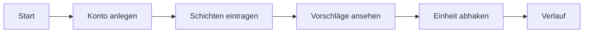

# User-Flows

| ID | Flow | Ablauf | Fehler- und Missbrauchsfälle |
|---|---|---|---|
| FL-01 | Erster Start | Konto anlegen → Zeitzone bestätigen → erste Schicht eintragen → erster Vorschlag | E-Mail schon vergeben: gleiche Antwort wie bei neuem Konto (keine Enumeration) |
| FL-02 | Woche planen | Schichten der Woche eintragen → Vorschläge ansehen → Einheit abhaken | Schicht über Mitternacht; Ende vor Beginn; Eintrag in der nicht existierenden Stunde der Zeitumstellung |
| FL-03 | Fremder Zugriff | Nutzer ändert die ID in der Adresszeile | Zugriff verweigert nach Strategie (404), keine fremden Daten |

