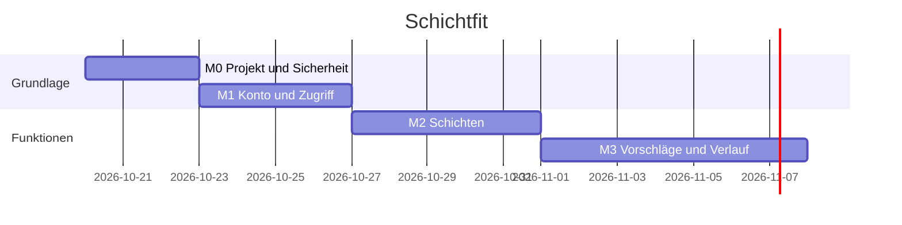

# Roadmap & Aufgaben

## Aufgaben
| ID | Meilenstein | Titel | Bezug | Akzeptanzkriterien | Sicherheit | Abhängig von | Größe | Status |
|---|---|---|---|---|---|---|---|---|
| TASK-001 | M0 | Projekt mit Vite und TypeScript anlegen, CI einrichten | – | Startseite lädt, Lint und Tests laufen in CI | Regeln 1.3, 9.6 | – | S | offen |
| TASK-002 | M0 | Datenbank mit Zugriffsregeln und Secret-Scan | BD-05, T-SEC-06 | – | Regeln 1.1–1.3, 2.2 | TASK-001 | M | offen |
| TASK-003 | M1 | Konto anlegen und anmelden | F-01, T-SEC-03, T-SEC-04 | AK-F01-1, AK-F01-2 | Regeln 3.1, 3.4, 4.1 | TASK-002 | M | offen |
| TASK-004 | M2 | Schichten eintragen mit Besitzprüfung | F-02, T-SEC-01, T-SEC-02, T-SEC-05 | AK-F02-1, AK-F02-2, AK-F02-3 | Regeln 2.1–2.6 | TASK-003 | M | offen |
| TASK-005 | M3 | Vorschlagslogik mit Zeitzonen-Tests | F-03 | AK-F03-1, AK-F03-2 | – | TASK-004 | M | offen |
| TASK-006 | M3 | Abhaken und Verlauf | F-06 | AK-F06-1 | Regel 2.1 | TASK-005 | S | offen |

## Definition of Done
- [x] Sicherheitsgrundlagen vor Fachfunktionen
- [x] Jede Muss-Funktion, jeder Pflicht-`T-SEC` hat eine `TASK`
