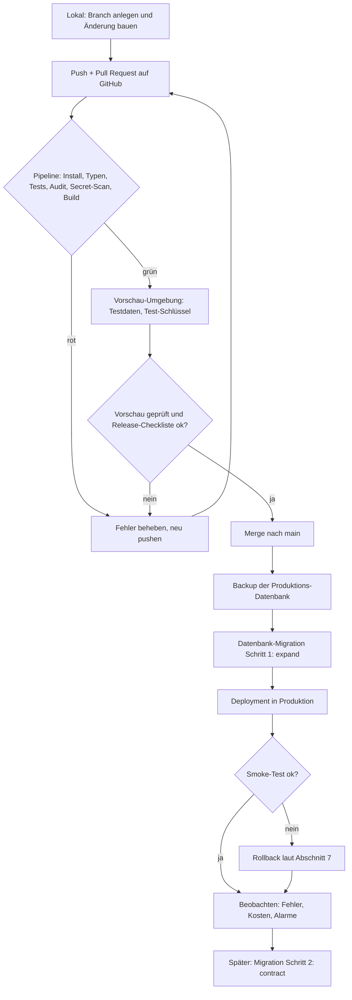

# Auslieferung – von der Änderung bis zur Produktion

> Kurz: Wie kommt eine Änderung sicher vom eigenen Rechner zu den Nutzern – und wie holst du sie wieder zurück, wenn etwas schiefgeht?

Dieser Leitfaden gehört zu Phase 20 (`phases/20-betrieb.md`) und ergänzt Phase 13 (`phases/13-tech-stack-und-architektur.md`, Umgebungen) und Phase 19 (`phases/19-qualitaet-und-tests.md`, Tests). Er ist für Einsteiger geschrieben: Jeder Fachbegriff wird beim ersten Auftreten erklärt (siehe auch `guides/glossar.md`).

**Wichtig vorab:** Diese Seite beschreibt Vorgehensweisen, keine Zahlenvorgaben. Konkrete Werte (Backup-Häufigkeit, Aufbewahrung, Wiederherstellungstest, Log-Fristen) stehen nur in `security/standardwerte.md`. Namen von Werkzeugen sind Beispiele – prüfe Funktionen, Preise und Regionen vor der Entscheidung selbst.

---

## 1. Das Grundprinzip: Nie direkt in Produktion arbeiten

Stell dir ein Restaurant vor: Neue Rezepte probierst du in der Testküche aus, nicht am Tisch des Gastes. Bei einer App heißt das:

- Du baust und probierst **lokal** auf deinem Rechner.
- Du prüfst jede Änderung in einer **Vorschau-Umgebung**, die wie die echte App aussieht, aber **keine echten Nutzerdaten** enthält.
- Erst danach geht die Änderung in **Produktion** – die echte App, die Nutzer verwenden.

Der häufigste Einsteigerfehler ist, Änderungen „schnell mal direkt live“ zu machen. Das ist genau der Weg, auf dem Daten verloren gehen oder Sicherheitsregeln versehentlich abgeschaltet werden (vgl. Regel 10.4 in `security/regeln-fuer-ki.md`).

---

## 2. Umgebungen

Eine **Umgebung** ist eine vollständige, getrennte Ausgabe deiner App mit eigener Datenbank, eigenen Schlüsseln und eigener Adresse.

| Umgebung | Wofür | Daten | Wer hat Zugriff | Typische Adresse |
|---|---|---|---|---|
| **Lokal** (Entwicklung) | Bauen und ausprobieren auf deinem Rechner | **Erfundene Testdaten**, nie ein Abzug echter Nutzerdaten | nur du | `localhost` |
| **Vorschau / Staging** (Test) | Jede Änderung ansehen und testen, bevor sie live geht | Erfundene Testdaten, getrennte Datenbank | du und Tester | eigene Test-Adresse, die nicht für Suchmaschinen gedacht ist |
| **Produktion** | Die echte App für echte Nutzer | echte Nutzerdaten | so wenige Personen wie möglich, mit 2FA | deine echte Domain |

Regeln, die für alle Umgebungen gelten:

1. **Getrennte Datenbanken.** Die Vorschau darf nie dieselbe Datenbank wie die Produktion benutzen. Sonst zerstört ein Test echte Daten.
2. **Getrennte Schlüssel.** Jede Umgebung hat eigene Geheimnisse (siehe Abschnitt 5). Ein Schlüssel aus Produktion gehört niemals auf einen Entwickler-Rechner.
3. **Keine echten Nutzerdaten außerhalb der Produktion.** Wenn du echte Fehler nachstellen musst, nimm erfundene Daten, die dem Problem ähneln. Ein Kopieren der Produktionsdaten in die Vorschau wäre eine zusätzliche Datenverarbeitung mit eigenem Schutzbedarf (Datenschutz, Phase 16) – vermeide es.
4. **Test-Zahlungen und Test-Mails.** In Vorschau und lokal nutzt du die Testmodi der Dienste (Zahlungsanbieter, E-Mail, SMS). So gehen keine echten Mails an Nutzer und es werden keine echten Zahlungen ausgelöst.
5. **Vorschau schützen.** Eine Vorschau-Adresse sollte nicht frei im Netz stehen: Zugriffsschutz (z. B. Passwort oder Anmeldung beim Hosting-Anbieter) und ein „nicht indexieren“-Hinweis für Suchmaschinen. Sie enthält oft Funktionen, die noch nicht fertig geprüft sind.
6. **Sichtbar machen, wo man ist.** Ein deutlicher Hinweis in der Vorschau („TESTUMGEBUNG“) verhindert Verwechslungen.

Bei Stufe 1 (reine lokale App) reicht oft „lokal + Produktion“. Ab Stufe 2 empfiehlt Phase 13 eine eigene Vorschau-Umgebung; bei Stufe 3 ist sie dringend zu empfehlen.

---

## 3. Der Ablauf mit Git-Branches – für Einsteiger

**Git** ist die Versionsverwaltung: Sie merkt sich jede Änderung, du kannst jederzeit zurück. **GitHub** (oder ein ähnlicher Dienst) speichert das **Repository** (den Projektordner mit Verlauf) online. Ein **Branch** ist ein Seitenzweig: Du arbeitest an einer Änderung, ohne die funktionierende Hauptversion anzufassen. Ein **Pull Request** (kurz PR) ist die Bitte, einen Branch in die Hauptversion zu übernehmen; vorher laufen die automatischen Prüfungen und – falls vorhanden – schaut jemand drüber.

Die Hauptversion heißt meist `main`. **Regel: `main` ist immer in einem Zustand, den man veröffentlichen könnte.**

So sieht der Alltag aus:

1. **Neuen Branch anlegen**, benannt nach der Änderung (z. B. `feature/passwort-reset` oder `fix/login-fehlermeldung`). Bitte das KI-Coding-Tool, genau das zu tun – nie direkt auf `main` arbeiten.
2. **Kleine Schritte committen.** Ein **Commit** ist ein gespeicherter Zwischenstand mit kurzer Beschreibung. Lieber oft und klein als selten und riesig.
3. **Branch zu GitHub hochladen („push“) und einen Pull Request öffnen.** Jetzt starten automatisch Tests und Prüfungen (Abschnitt 4) und – je nach Hosting – wird eine **Vorschau-Adresse** für genau diese Änderung erzeugt.
4. **Prüfen:** Sind alle Prüfungen grün? Funktioniert die Vorschau? Stimmen die Akzeptanzkriterien (Phase 19)? Wer allein arbeitet, liest den PR trotzdem einmal selbst durch („Was genau ändert sich?“) – oder lässt eine zweite KI-Sitzung ohne Vorwissen darüber schauen (vgl. Zweitprüfung, `AGENTS.md` Abschnitt 14).
5. **In `main` übernehmen („mergen“).** Erst wenn alles grün ist.
6. **Veröffentlichen:** Je nach Einstellung geht `main` automatisch in Produktion oder erst nach einer bewussten Freigabe (Abschnitt 8).

**Schutzregeln für `main`** (in GitHub unter den Einstellungen für „Branch protection“ bzw. „Rulesets“ – genaue Bezeichnung und Verfügbarkeit je nach Plan und Repository-Art prüfen `[PRÜFEN]`):

- Direktes Pushen auf `main` sperren.
- Merge nur, wenn die automatischen Prüfungen grün sind.
- Bei mehreren Personen: mindestens eine Freigabe durch eine andere Person.

**Warum das für Einsteiger wichtig ist:** Wenn etwas schiefgeht, ist die Antwort fast immer „Gehe auf den letzten guten Stand zurück“. Das geht nur, wenn jede Änderung klar abgegrenzt ist.

---

## 4. Die CI/CD-Pipeline – was automatisch läuft

**CI** (Continuous Integration, „fortlaufende Zusammenführung“) bedeutet: Bei jeder Änderung laufen automatisch Prüfungen. **CD** (Continuous Delivery bzw. Deployment, „fortlaufende Auslieferung“) bedeutet: Wenn die Prüfungen bestanden sind, wird die Änderung automatisch (oder per Knopfdruck) veröffentlicht. Zusammen heißt der Ablauf **Pipeline**. Bei GitHub heißt das Werkzeug dafür **GitHub Actions**; die Abläufe stehen als Dateien im Repository (Ordner `.github/workflows/`).

Eine sinnvolle Pipeline für eine kleine App besteht aus diesen Stufen, **in dieser Reihenfolge** (schnelle und billige Prüfungen zuerst):

| Stufe | Was passiert | Wozu | Bei Fehler |
|---|---|---|---|
| 1. **Abhängigkeiten sauber installieren** | Genau die Versionen aus dem Lockfile installieren (bei npm: `npm ci`, es bricht ab, wenn Lockfile und `package.json` nicht zusammenpassen) `[Q-A01]` | Reproduzierbarer Stand wie bei dir lokal | Stopp |
| 2. **Formatierung und Typprüfung** | Code-Stil und Typen (TypeScript) prüfen | Einfache Fehler früh finden | Stopp |
| 3. **Automatische Tests** | Funktionstests und die Sicherheitstests aus Phase 19, inkl. Test „anderer Nutzer darf nicht zugreifen“ (Regeln 10.1, 10.2) | Fehler erkennen, bevor Nutzer sie sehen | Stopp |
| 4. **Abhängigkeitsprüfung** | Bekannte Schwachstellen in Fremdbibliotheken suchen (bei npm: `npm audit`; mit `--audit-level` legst du die Schwelle fest, ab der die Prüfung fehlschlägt) `[Q-A02]` | Regel 9.2 | Stopp bei hoch/kritisch, sonst dokumentieren |
| 5. **Secret-Scan** | Prüfen, ob versehentlich Passwörter oder Schlüssel im Code stehen. GitHub bietet dafür „Secret Scanning“ mit „Push Protection“ an, das Pushes mit erkannten Geheimnissen blockiert; Verfügbarkeit je nach Repository-Art und Plan prüfen `[Q-A03]` `[PRÜFEN]`. Alternativ: ein Open-Source-Scanner in der Pipeline | Regeln 1.1, 1.3, 1.4 | Stopp, Geheimnis **sofort widerrufen** |
| 6. **Build** | Die App „bauen“, also in die auslieferbare Form bringen | Sicherstellen, dass sie überhaupt baut | Stopp |
| 7. **Deployment in die Vorschau** | Gebaute App in die Vorschau-Umgebung bringen | Ansehen und Testen mit realistischer Umgebung | Stopp |
| 8. **Freigabe** | Mensch entscheidet (oder bei sehr kleinen Projekten: automatisch nach grüner Pipeline) | Kontrolle vor der Veröffentlichung | – |
| 9. **Deployment in Produktion** | Gleiche gebaute App, **nur mit den Einstellungen der Produktion** | Veröffentlichen | Rollback (Abschnitt 7) |
| 10. **Smoke-Test nach dem Deployment** | Wenige entscheidende Schritte automatisch oder von Hand prüfen: App erreichbar? Login geht? Kernfunktion geht? | Sofort merken, wenn etwas nicht stimmt | Rollback |

Wichtige Grundsätze:

- **Einmal bauen, überall einsetzen.** Die Produktion bekommt dieselbe gebaute Version, die in der Vorschau getestet wurde – nicht einen neuen, anderen Build. Unterschiede liegen nur in der Konfiguration (Abschnitt 5 und 9).
- **Rot heißt Stopp.** Eine fehlschlagende Prüfung wird nie „vorübergehend“ ausgeschaltet (Regel 10.4). Wenn eine Prüfung stört, ist die Antwort: Ursache klären, nicht abschalten.
- **Die Pipeline selbst ist Angriffsfläche.** Sie besitzt Schlüssel für das Hosting. Wie du sie absicherst, steht in `guides/lieferkette.md` (Abschnitt „GitHub Actions und CI absichern“).
- **Wer darf in Produktion veröffentlichen?** Nur wer es muss, mit 2FA. Für Produktions-Geheimnisse bietet GitHub „Environments“ mit Freigabe durch benannte Personen an (Required Reviewers) `[Q-A04]`.
- Die Pipeline ist **kein Ersatz** für die Tests aus Phase 19, sondern führt sie automatisch aus.

### Ablauf als Diagramm

---

## 5. Geheimnisse pro Umgebung

Ein **Geheimnis** (Secret) ist ein Wert, der Zugang gibt: Datenbank-Passwort, geheimer API-Schlüssel, Webhook-Secret. Die Grundregeln stehen in `security/regeln-fuer-ki.md` (Abschnitt 1, Regeln 1.1 bis 1.4). Hier die Anwendung auf die Auslieferung:

1. **Jede Umgebung hat eigene Geheimnisse.** Ein Leck in der Vorschau darf nie die Produktion gefährden.
2. **Geheimnisse liegen im Tresor, nicht im Code.** Quellen: die Secret-/Variablen-Verwaltung deines Hosting-Anbieters, von GitHub Actions (Repository- bzw. Environment-Secrets) oder ein Passwort-Manager. Im Repository steht nur eine `.env.example` mit Platzhaltern (Regel 1.3).
3. **Konfiguration vom Code trennen.** Alles, was zwischen Umgebungen verschieden ist (Datenbank-Adresse, Zugangsdaten, Hostnamen), gehört in **Umgebungsvariablen** – nicht in den Code. Der Praxistest aus dem „Twelve-Factor App“-Ansatz: Du könntest den Code jederzeit öffentlich machen, ohne Zugangsdaten preiszugeben `[Q-A05]`.
4. **Client-Präfixe beachten.** Variablen mit Präfixen wie `VITE_`, `NEXT_PUBLIC_` oder `EXPO_PUBLIC_` landen im Browser/der App und sind für jeden lesbar. Dort stehen niemals geheime Schlüssel (Regel 1.1).
5. **Nur so viel Zugriff wie nötig.** Der Schlüssel der Pipeline darf nur das Nötigste (Vorschau und Produktion bedienen), nicht die ganze Cloud-Konsole. GitHub empfiehlt für Zugangsdaten das Prinzip der minimalen Rechte, kein Klartext in Workflow-Dateien und jedes Geheimnis als eigenen Eintrag (keine zusammengepackten JSON-Blöcke), weil das Schwärzen in Logs sonst oft scheitert `[Q-A04]`.
6. **Rotation.** Geheimnisse regelmäßig erneuern und nicht mehr benötigte entfernen `[Q-A04]`. Rhythmus legst du in Phase 20 fest; wer hat welches Geheimnis, steht in der Zugangsliste.
7. **Leck = sofort widerrufen.** Versehentlich veröffentlichte Geheimnisse werden sofort widerrufen und neu erzeugt; Löschen aus der Git-Historie reicht nicht (Regel 1.4). Erscheint ein Geheimnis in einem Pipeline-Log, das Log löschen **und** das Geheimnis erneuern `[Q-A04]`. Ablauf: `templates/incident-plan.md`.
8. **Übersichtstabelle** (in `20-betrieb.md` pflegen, ohne die Werte selbst!):

| Geheimnis | Zweck | Lokal | Vorschau | Produktion | Wo gespeichert | Wer hat Zugriff | Zuletzt erneuert |
|---|---|---|---|---|---|---|---|
| z. B. Datenbank-Passwort | Datenbankzugriff | eigene Test-DB | eigene Test-DB | Produktions-DB | Hosting-Tresor | nur Pipeline + Inhaber | … |

---

## 6. Datenbank-Änderungen (Migrationen) sicher durchführen

Die Datenbank ist der gefährlichste Teil einer Auslieferung: Code lässt sich zurückdrehen, **gelöschte oder umgeformte Daten nicht**. Eine **Migration** ist eine versionierte Anweisung („füge Spalte hinzu“, „lege Tabelle an“), die in einer festen Reihenfolge ausgeführt wird und im Repository nachvollziehbar gespeichert ist.

### Die Regeln

1. **Nie manuell in der Produktionsdatenbank ändern.** Keine „kurzen Eingriffe“ in einer Datenbank-Oberfläche. Jede Änderung ist eine Migrationsdatei im Repository, die erst lokal, dann in der Vorschau und erst danach in Produktion läuft. Ausnahme nur im Notfall, dann dokumentiert (`ENTSCHEIDUNGEN.md`) und anschließend als Migration nachgezogen.
2. **Backup vorher – und die Wiederherstellung muss funktionieren.** Vor jeder Migration, die Daten verändert oder löscht, ein frisches Backup der Produktion anlegen. Häufigkeit, Aufbewahrung und Wiederherstellungstest: `security/standardwerte.md`, Abschnitt 10. Ein Backup, das nie zurückgespielt wurde, zählt nicht.
3. **Migrationen sind vorwärts gerichtet und klein.** Lieber drei kleine Migrationen als eine große. Eine einmal in Produktion gelaufene Migration wird nicht mehr bearbeitet, sondern durch eine neue korrigiert.
4. **Test an realistischen Daten.** Teste die Migration in der Vorschau mit erfundenen, aber ähnlich geformten Daten (z. B. leere Felder, sehr lange Texte, Umlaute, Sonderfälle).
5. **Row Level Security mitdenken.** Neue Tabellen werden immer mit aktivierter Zugriffskontrolle angelegt (Regel 2.2). Eine Migration, die eine Tabelle ohne Regeln anlegt, ist ein Sicherheitsfehler.
6. **Rückwärtskompatibel in zwei Schritten (expand / contract).** Siehe unten.
7. **Reihenfolge:** Erst die Datenbank so erweitern, dass alter **und** neuer Code funktioniert – dann den neuen Code ausliefern – erst viel später aufräumen.

### Expand / Contract – das Zwei-Schritt-Muster

Das Muster heißt „Parallel Change“ oder „expand and contract“: Man erweitert zuerst die Schnittstelle, sodass Altes und Neues nebeneinander funktionieren (**expand**), stellt dann alle Nutzer des Alten um (**migrate**) und entfernt erst am Ende das Alte (**contract**) `[Q-A06]`.

**Warum?** Beim Ausliefern läuft für kurze Zeit alter und neuer Code gleichzeitig (Nutzer haben die alte Seite noch offen, Apps im Store sind noch auf dem alten Stand). Würdest du eine Spalte in einem Schritt umbenennen, bricht der alte Code sofort. Und ein Rollback auf die alte Version wäre unmöglich, weil sie die neue Datenbank nicht versteht.

**Beispiel: Spalte `name` soll in `vorname` und `nachname` aufgeteilt werden.**

| Schritt | Datenbank | Code | Rollback möglich? |
|---|---|---|---|
| **Expand 1** | Neue Spalten `vorname`, `nachname` hinzufügen (leer erlaubt). `name` bleibt. | Alter Code läuft unverändert weiter. | Ja, nichts wurde zerstört |
| **Expand 2** | Bestehende Namen in die neuen Spalten kopieren (Backfill, in kleinen Portionen). | Neuer Code **schreibt in beide** Varianten und **liest** die neuen Spalten (mit Rückfall auf `name`). | Ja |
| **Migrate** | Prüfen, dass alle Datensätze in den neuen Spalten stehen. | Alle Nutzer laufen auf neuem Code (Zeit abwarten: offene Browser-Tabs, App-Store-Versionen). | Ja, solange `name` noch gefüllt wird |
| **Contract** | Spalte `name` entfernen – **nach Backup**, in einem **späteren, eigenen Release**. | Code, der `name` noch kennt, wird entfernt. | **Nein** – ab hier nur noch aus dem Backup |

Merksatz: **Zerstörerische Schritte (löschen, umbenennen, Typ ändern) sind immer ein eigener Release, nie im selben wie die Code-Änderung.** Der Contract-Schritt muss wirklich stattfinden, sonst sammeln sich alte Spalten und Sonderfälle an `[Q-A06]`; trage ihn als Aufgabe (`TASK-…`) ein.

### Typische Fallen

- **Neue Pflichtspalte ohne Standardwert** in einer großen Tabelle: kann Tabelle blockieren oder scheitert an vorhandenen Zeilen → erst optional anlegen, füllen, dann Pflicht machen.
- **Große Datenumformungen in einem Rutsch:** können die App lahmlegen → in Portionen, außerhalb der Hauptnutzungszeit.
- **Migration und Code in einem Rutsch ausrollen:** Das Zeitfenster dazwischen führt zu Fehlern. Reihenfolge einhalten (Punkt 7).
- **Automatische Migration bei jedem Start:** nur, wenn sie idempotent (mehrfach ausführbar ohne Schaden) und getestet ist.
- **Verwaiste Daten nach Löschung:** Personenbezogene Daten müssen auch aus Backups nach deren Frist verschwinden (Regel 7.3); plane Löschmigrationen mit Blick auf das Löschkonzept (`templates/loeschkonzept.md`).

---

## 7. Rollback – den letzten guten Stand wiederherstellen

Ein **Rollback** ist die Rückkehr auf die vorherige Version. Entscheide **vor** dem Release, wie er geht – nicht erst im Notfall.

| Was wurde geändert? | Rollback-Weg | Bedingung |
|---|---|---|
| Nur Code (Web-App) | Vorherigen Deployment-Stand beim Hosting-Anbieter wieder aktivieren **oder** den fehlerhaften Merge in Git rückgängig machen („revert“) und die Pipeline laufen lassen | Datenbank ist mit beiden Versionen kompatibel (expand-Prinzip!) |
| Code + **erweiternde** Migration (expand) | Wie oben; die zusätzlichen Spalten bleiben ungenutzt stehen | siehe Abschnitt 6 |
| Code + **zerstörende** Migration (contract) | **Kein einfacher Rollback.** Nur Wiederherstellung aus Backup (Datenverlust seit Backup!) oder Korrektur nach vorn | Darum contract nie mit anderen Änderungen mischen |
| Konfiguration / Geheimnis | Alten Wert wiederherstellen (aus Tresor-Historie bzw. Notiz) | – |
| Mobile App im Store | Store-Version lässt sich meist nicht zurückziehen, nur durch eine neue Version ersetzen; Sperrmöglichkeit über Feature-Flag oder Server-seitig (Abschnitt 8) | Vorab klären, siehe `guides/appstore-veroeffentlichung.md` |
| Fehlerhafte Funktion | Feature-Flag ausschalten (Abschnitt 8) – schneller als jeder Rollback | Flag war vorhanden |

**Rollback-Kriterium festlegen (vorab, schriftlich):** Ein Rollback wird ausgelöst, wenn z. B. der Smoke-Test scheitert, ein Sicherheitsproblem sichtbar wird, Daten falsch geschrieben werden oder die Fehlerrate nach dem Release deutlich steigt. Die genauen Schwellen legst **du** fest und trägst sie in `templates/release-checkliste.md` ein – mit Namen der Person, die entscheidet. Im Zweifel gilt: lieber zurückrollen und in Ruhe analysieren als im Live-Betrieb basteln.

**Rollback üben:** Ein nie getesteter Rollback ist wie ein nie getestetes Backup. Übe ihn mindestens einmal vor dem Launch in der Vorschau-Umgebung.

---

## 8. Feature-Flags

Ein **Feature-Flag** (auch Feature-Toggle) ist ein Schalter, der eine Funktion ein- oder ausschaltet, ohne neuen Code auszuliefern.

### Wofür sie nützlich sind `[Q-A07]`

| Art | Zweck | Lebensdauer |
|---|---|---|
| **Release-Flag** | Unfertigen Code mit ausliefern, aber noch verbergen; Funktion erst freischalten, wenn sie fertig und getestet ist | kurz – nach dem Start wieder entfernen |
| **Ops-Flag / Kill-Switch** | Eine teure oder fehleranfällige Funktion bei Problemen schnell abschalten (z. B. KI-Funktion bei Kostenexplosion) | oft dauerhaft |
| **Experiment-Flag** | Zwei Varianten vergleichen (A/B-Test) | nur während des Experiments |
| **Berechtigungs-Flag** | Funktionen für bestimmte Nutzergruppen (z. B. Premium) | lang |

Für Einsteiger sind **Kill-Switches** für kostenverursachende Funktionen (Phase 17) und **Release-Flags** für größere neue Funktionen am sinnvollsten. Experimente brauchen eine Datenschutzbetrachtung (Tracking, Einwilligung, Phase 16).

### Risiken `[Q-A07]`

1. **Flags sind Altlasten mit Kosten.** Jeder Schalter verdoppelt die Zustände, die getestet werden müssten. Plane das Entfernen eines Release-Flags **schon beim Einführen** als Aufgabe ein; führe eine Liste mit Besitzer und Ablaufdatum.
2. **Sicherheit: Flags dürfen keine Zugriffskontrolle ersetzen.** Ein ausgeschalteter Button ist keine Berechtigungsprüfung (Regel 2.9). Auch wenn eine Funktion „versteckt“ ist, muss der Server sie trotzdem absichern, denn jemand ruft die Adresse direkt auf.
3. **Flags nicht vom Nutzer steuerbar machen.** Werte, die der Browser selbst überschreiben kann (z. B. über die Adresszeile), könnten Funktionen freischalten; Flags werden serverseitig entschieden `[Q-A07]`.
4. **Zu viele Kombinationen.** Getestet wird vor allem die geplante Produktionseinstellung und der Rückfall, wenn der Flag-Dienst nicht erreichbar ist (sicherer Standardwert!).
5. **Vergessene Flags.** Ein alter, plötzlich umgeschalteter Flag kann alte, unsichere Wege wieder aktivieren. Das Beispiel eines Handelsunternehmens, das durch falsch verwaltete Flags enorme Verluste erlitt, nennt die Fachliteratur als Warnung `[Q-A07]`.
6. **Datenbank-Änderungen bleiben:** Ein Flag schaltet nur Code, keine Migration zurück (Abschnitt 6).
7. **Standardwert „aus“** für neue Funktionen, die Daten schreiben oder Geld kosten.

Fürs Erste genügt oft eine einfache Konfiguration (Umgebungsvariable oder Tabelle in der Datenbank). Ein eigener Flag-Dienst lohnt sich erst, wenn es viele Flags oder Nutzergruppen gibt.

---

## 9. Zeitzonen- und Konfigurationsunterschiede zwischen Umgebungen

Dieselbe App verhält sich in Umgebungen oft unterschiedlich, obwohl der Code gleich ist. Typische Ursachen:

| Unterschied | Folge | Gegenmaßnahme |
|---|---|---|
| **Zeitzone des Servers** (Hosting-Server laufen häufig in UTC, dein Rechner in deutscher Zeit) | Termine, „heute“, Tagesgrenzen, Cron-Jobs und Auswertungen verschieben sich um 1–2 Stunden | Zeiten **immer in UTC speichern** und erst bei der Anzeige in die Zeitzone des Nutzers umrechnen (Details: `phases/18-nicht-funktionale-anforderungen.md`). Zeitzone der Server **explizit** festlegen und in `13-architektur.md` dokumentieren |
| **Sommerzeit** | Ein Tag hat 23 oder 25 Stunden; geplante Jobs laufen doppelt oder gar nicht | Geplante Jobs in UTC planen; Tests mit Datumsangaben rund um die Zeitumstellung |
| **Sprach- und Formateinstellungen (Locale)** des Servers | Datum, Dezimaltrennzeichen, Sortierung unterscheiden sich | Locale im Code ausdrücklich angeben statt sich auf Systemstandard zu verlassen |
| **Betriebssystem / Version von Laufzeitumgebung** | „Bei mir geht es“ | Versionen im Projekt festschreiben (z. B. Angabe der Laufzeit-Version, Lockfile) und in der Pipeline dieselbe Version nutzen |
| **Umgebungsvariablen** | Variable fehlt in Produktion → Absturz oder, schlimmer, ein unsicherer Standardwert | App prüft beim Start, ob alle Pflicht-Variablen gesetzt sind, und **bricht sonst ab**; es gibt keine unsicheren Standardwerte (z. B. kein Standard-Admin-Passwort) |
| **Dienste im Testmodus** (Zahlung, E-Mail) | Etwas wird in Produktion nie getestet | Eigene Test-Checkliste für Produktion im Smoke-Test (`templates/release-checkliste.md`); nur mit Test-Konten bzw. kleinsten Beträgen |
| **Sicherheits-Header / HTTPS / Cookies** | In lokal ohne HTTPS funktionieren `Secure`-Cookies anders | Werte aus `security/standardwerte.md` in Vorschau und Produktion identisch halten; lokale Ausnahmen bewusst dokumentieren |
| **Datenmenge** | Mit zehn Testzeilen ist alles schnell, mit zehntausend nicht | Lasttest-Grobplanung in Phase 18 |
| **CORS / erlaubte Domains** | Die Vorschau hat eine andere Adresse | Erlaubte Adressen je Umgebung getrennt konfigurieren; nie `*` bei Endpunkten mit Anmeldung (Regel 6.3) |

---

## 10. Der Release-Ablauf in der Praxis

Ein **Release** ist das Veröffentlichen einer neuen Version. Die ausführliche Liste zum Abhaken ist `templates/release-checkliste.md`. Der Ablauf in Kürze:

1. **Vorbereiten:** Änderungen sind in `CHANGELOG.md` beschrieben, Pipeline ist grün, Vorschau getestet, offene Annahmen und Risiken geprüft.
2. **Zeitpunkt wählen:** Nicht freitagabends und nicht, wenn niemand erreichbar ist. Bei Apps mit Schichtbetrieb oder Stoßzeiten: außerhalb der Hauptnutzungszeit.
3. **Backup erstellen**, wenn Datenbank-Änderungen dabei sind.
4. **Migration (expand) ausführen**, dann Code ausliefern (Abschnitt 6).
5. **Smoke-Test** durchführen (Abschnitt 4, Stufe 10).
6. **Beobachten:** Fehler-Tracking, Alarme, Kosten und die Rückmeldungen im Support für die ersten Stunden im Blick behalten.
7. **Entscheiden:** Alles gut → Release als abgeschlossen markieren (Git-Tag oder Versionsnummer). Probleme → Rollback laut vorab festgelegtem Kriterium.
8. **Nachbereitung:** Aufräumaufgaben (contract-Schritt, Flag entfernen) eintragen; bei Zwischenfällen eine kurze Nachbetrachtung (siehe `templates/incident-plan.md`).

**Versionsnummern:** Eine übliche Schreibweise ist „Hauptversion.Nebenversion.Fehlerkorrektur“ (**Semantic Versioning**, z. B. 1.4.2) – wichtig ist vor allem, dass jede ausgelieferte Version eindeutig benennbar ist, damit Support und Rollback wissen, worüber gesprochen wird.

**Dringende Sicherheitskorrekturen („Hotfix“)** laufen durch dieselbe Pipeline, nur schneller und mit kleinstmöglicher Änderung. Die Prüfungen werden nicht übersprungen (Regel 10.4).

---

## 11. Was du in Phase 20 daraus festhalten solltest

- Welche Umgebungen es gibt und wie sie getrennt sind (Datenbank, Schlüssel, Domain).
- Die Pipeline-Stufen und wer Produktion freigeben darf.
- Die Geheimnis-Übersicht (ohne Werte).
- Das Migrationsvorgehen (Backup, expand/contract, kein manueller Eingriff).
- Das Rollback-Kriterium und der Rollback-Weg je Art der Änderung.
- Welche Feature-Flags/Kill-Switches es gibt und wer sie bedient.
- Der Release-Ablauf mit Verweis auf `templates/release-checkliste.md`.

---

## Quellen

Alle Belege wurden am 2026-10-14 abgerufen. Die IDs `Q-A01` bis `Q-A07` sind Verweise in diesem Leitfaden; in einem Projekt übernimmst du genutzte Belege mit projekteigenen IDs in `QUELLEN.md`.

| ID | Aussage | URL | Art | Prüfdatum |
|---|---|---|---|---|
| Q-A01 | `npm ci` setzt ein Lockfile voraus, bricht bei Abweichung zu `package.json` ab, löscht vorhandenes `node_modules` und schreibt Lockfile/`package.json` nicht | https://docs.npmjs.com/cli/v10/commands/npm-ci | Primärquelle (Herstellerdoku) | 2026-10-14 |
| Q-A02 | `npm audit` fragt bekannte Schwachstellen ab; `--audit-level` legt nur die Fehlschlag-Schwelle fest, filtert den Bericht nicht; benötigt standardmäßig ein Lockfile | https://docs.npmjs.com/cli/v10/commands/npm-audit | Primärquelle | 2026-10-14 |
| Q-A03 | GitHub Secret Scanning „Push Protection“ blockiert Pushes mit erkannten Geheimnissen; Repository-Variante setzt GitHub Secret Protection voraus und ist standardmäßig aus | https://docs.github.com/en/code-security/secret-scanning/introduction/about-push-protection | Primärquelle | 2026-10-14 |
| Q-A04 | GitHub-Empfehlungen: Least Privilege, keine Geheimnisse im Klartext in Workflows, einzelne Secrets statt strukturierter Blöcke, regelmäßig rotieren, Required Reviewers für Environment-Secrets, Log löschen und Secret rotieren bei Leck | https://docs.github.com/en/actions/security-for-github-actions/security-guides/security-hardening-for-github-actions | Primärquelle | 2026-10-14 |
| Q-A05 | Konfiguration gehört in Umgebungsvariablen, getrennt vom Code; Prüfkriterium: Code könnte jederzeit offengelegt werden, ohne Zugangsdaten zu verraten | https://12factor.net/config | Bericht/Methodik (anerkannte Praxis, kein Gesetz) | 2026-10-14 |
| Q-A06 | Parallel Change (expand → migrate → contract): neue Variante ergänzen, Nutzer umstellen, Altes erst am Ende entfernen; Contract-Schritt muss abgeschlossen werden (Danilo Sato, veröffentlicht 2014-05-13) | https://martinfowler.com/bliki/ParallelChange.html | Bericht/Artikel (Fachliteratur) | 2026-10-14 |
| Q-A07 | Arten, Lebensdauer und Risiken von Feature-Toggles (Release/Ops/Experiment/Permissioning; Toggles sind Bestand mit Kosten; Entfernen einplanen; Per-Request-Overrides bergen Manipulationsrisiko); Hinweis auf Knight Capital als Warnbeispiel (Pete Hodgson, 2016, zuletzt überarbeitet 2017-10-09) | https://martinfowler.com/articles/feature-toggles.html | Bericht/Artikel (Fachliteratur) | 2026-10-14 |

Offene Prüfpunkte: Genaue Bezeichnung und Verfügbarkeit der Schutzregeln für `main` („Branch protection“ / „Rulesets“) sowie der Secret-Scanning-Funktionen hängen von GitHub-Plan und Repository-Art ab `[PRÜFEN]`.
