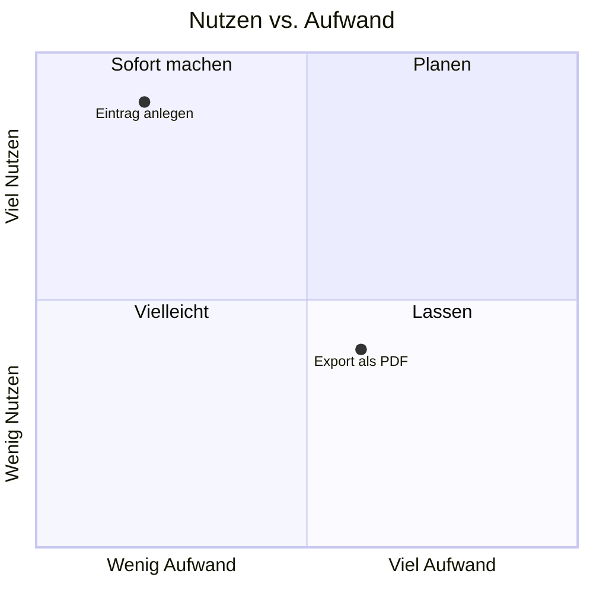

# Phase 5 – MVP-Umfang

> Kurz: Was muss die erste Version können – und was kommt bewusst später?

| | |
|---|---|
| **Ziel** | Klare Feature-Liste mit Prioritäten; bewusste Ausschlüsse |
| **Ergebnis** | `projekte/<slug>/05-mvp.md` |
| **Visual** | Priorisierungs-Matrix (Nutzen × Aufwand) als Mermaid-Quadrant oder Tabelle |
| **Dauer** | ca. 15–20 Minuten |
| **Überspringen** | nie |

## Für Einsteiger erklärt

**MVP** heißt „Minimum Viable Product“ – die kleinste Version, die das Kernproblem wirklich löst. Der häufigste Fehler ist, zu viel auf einmal zu wollen. Jede zusätzliche Funktion kostet Zeit, macht die App komplizierter und bringt neue Fehler- und Sicherheitsrisiken. Wir sortieren deshalb hart: **Muss**, **Sollte**, **Später** und **Nie**.

## Fragen

**Q1 – Welche Funktionen stellst du dir vor?** Liste alles auf, was dir einfällt – auch Kleinigkeiten. (Die KI ergänzt danach typische vergessene Funktionen.)

**Q2 – Wenn die App nur EINE Sache könnte – welche wäre das?** (Das ist der Kern; alles andere ordnet sich darunter.)

**Q3 – Die KI legt eine Sortierung vor (Muss / Sollte / Später / Nie). Passt das so?** Der Nutzer verschiebt einzelne Punkte.

**Q4 – Bis wann soll die erste nutzbare Version fertig sein?**
- a) In 1–2 Wochen (sehr kleiner MVP)
- b) In 1–2 Monaten
- c) Kein fester Termin

**Q5 – Wie viel Zeit kannst du pro Woche investieren?** (Beeinflusst, wie klein der MVP sein muss.)

## Was die KI selbst ergänzen soll

- **Vergessene Basis-Funktionen** vorschlagen, die fast jede App braucht – nur wenn sie zutreffen:
  - Konto anlegen, anmelden, abmelden, Passwort zurücksetzen
  - **Konto und Daten löschen** (rechtlich und in App Stores Pflicht, wenn es Konten gibt)
  - **Daten exportieren** (DSGVO-Auskunftsrecht)
  - Einstellungen, Profil ändern
  - Leere Zustände („Noch keine Einträge – leg los!“)
  - Fehlermeldungen, Offline-Hinweis
  - Impressum / Datenschutzerklärung erreichbar
  - Feedback- oder Kontaktmöglichkeit
- **Priorisierung** nach Nutzen und Aufwand; begründe jede „Muss“-Funktion in einem Halbsatz.
- Benenne offen, wenn der „Muss“-Bereich zu groß ist („Das sind 14 Muss-Funktionen – realistisch für einen ersten Wurf sind 4–7.“).
- Formuliere für jede Muss-Funktion eine **User Story**: „Als <Persona> möchte ich <Aktion>, damit <Nutzen>.“
- Vergib jeder Funktion eine feste ID `F-01`, `F-02` … (`AGENTS.md` Abschnitt 11). IDs werden nie neu vergeben; gestrichene Funktionen bleiben mit Priorität `gestrichen` stehen.
- Behauptungen über Wettbewerber oder Nutzerverhalten mit Beleg `[Q-…]` oder als Annahme.

## Missbrauchs- und Sicherheitscheck

- Jede Funktion, die **Daten teilt, hochlädt, versendet oder öffentlich macht** (Teilen-Link, Upload, Kommentar, Chat, Einladung), markieren → besondere Prüfung in Phase 14.
- Funktionen, die **Kosten verursachen** (SMS, E-Mail-Versand, KI-Abfragen, Kartendienste), markieren → Kostenlimits in Phase 14 und 17.
- Admin-Funktionen nicht „mal eben“ einbauen, sondern als eigene Rolle planen (Phase 12).

## Ergebnis-Dokument `05-mvp.md`

```markdown
# MVP-Umfang

## Kernfunktion
…

## Funktionen
| ID | Funktion | Priorität | User Story | Aufwand (S/M/L) | 🔒 Risiko-Markierung |
|---|---|---|---|---|---|
| F-01 | … | Muss | Als … möchte ich …, damit … | M | teilt Daten |

## Bewusst NICHT in Version 1
- …

## Rahmen
- Ziel-Termin: …
- Zeitbudget pro Woche: …

## Matrix
(Mermaid-Quadrant: x = Aufwand, y = Nutzen)
```

Beispiel-Mermaid:

````markdown

````

## Definition of Done
- [ ] Kernfunktion in einem Satz
- [ ] Jede Funktion hat eine ID `F-…` und ist priorisiert (Muss / Sollte / Später / Nie)
- [ ] Muss-Liste realistisch zum Zeitbudget
- [ ] Konto-Löschung und Datenexport berücksichtigt (falls Konten)
- [ ] Riskante Funktionen markiert

→ **Standard-Gate**
