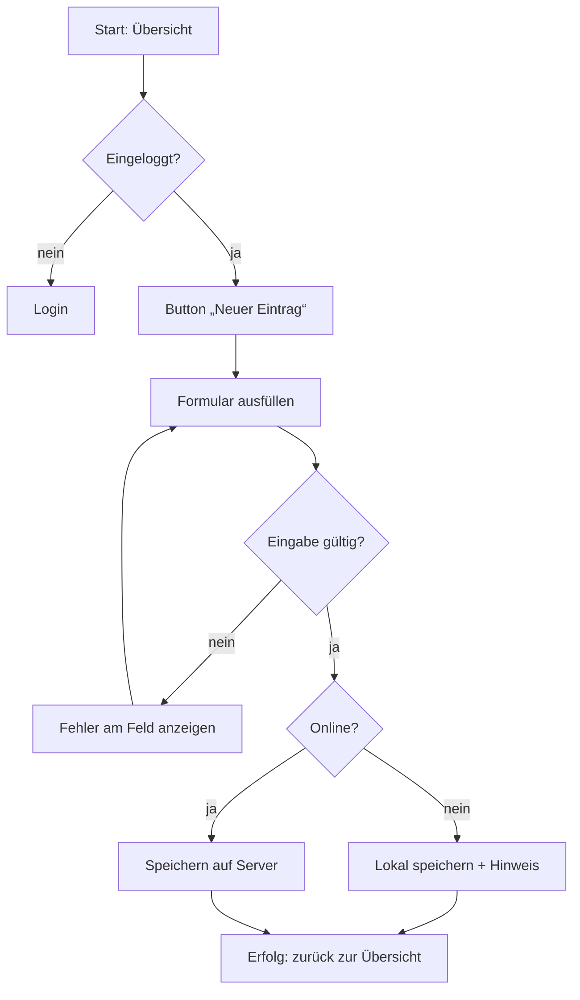

# Phase 6 – User-Flows & Zustände

> Kurz: Welche Schritte geht ein Nutzer – auch wenn etwas schiefgeht?

| | |
|---|---|
| **Ziel** | Für jede Muss-Funktion einen Ablauf inkl. Lade-, Leer- und Fehlerzuständen |
| **Ergebnis** | `projekte/<slug>/06-flows.md` |
| **Visual** | Mermaid-Flussdiagramme (je Haupt-Flow eins) |
| **Dauer** | ca. 20–30 Minuten |
| **Überspringen** | nie |

## Für Einsteiger erklärt

Ein **User-Flow** zeigt Schritt für Schritt, was ein Nutzer tut, um ein Ziel zu erreichen – etwa „Neuen Eintrag speichern“. Wichtig sind nicht nur die Schritte, wenn alles klappt („Happy Path“), sondern auch: Was passiert ohne Internet? Bei falscher Eingabe? Wenn noch nichts da ist? Genau diese Fälle werden beim Bauen sonst vergessen.

## Ablauf für die KI

1. Nimm die Muss-Funktionen aus Phase 5 und gruppiere sie zu **3–6 Haupt-Flows** (z. B. Onboarding, Eintrag anlegen, Übersicht ansehen, Teilen, Konto löschen). Jeder Flow bekommt eine ID `FL-01 …` und nennt die Funktionen `F-…`, die er abdeckt.
2. Schlage für den ersten Flow einen Entwurf vor (als Mermaid) und frage nach Korrekturen.
3. Gehe die Flows einzeln durch – pro Flow eine kurze Frage-Runde.

## Fragen (pro Flow)

**Q1 – Passt dieser Ablauf so?** (KI zeigt Entwurf.) Was fehlt oder ist anders?

**Q2 – Was soll passieren, wenn …** (KI wählt die relevanten Fälle aus)
- … der Nutzer noch keine Daten hat (Leerzustand)?
- … das Internet weg ist?
- … eine Eingabe ungültig ist?
- … der Server nicht antwortet?
- … der Nutzer mittendrin abbricht?
- … der Nutzer nicht berechtigt ist?

**Q3 (einmalig) – Wie kommt ein neuer Nutzer in die App?** (Onboarding)
- a) Direkt loslegen, Konto erst später **(Empfehlung, wenn möglich – weniger Abbrüche)**
- b) Zuerst Konto anlegen
- c) Kurze Einführung (2–3 Bildschirme), dann loslegen

## Was die KI selbst ergänzen soll

- Für jeden Flow: **Happy Path + Sonderfälle** als Mermaid-Diagramm.
- **Zustandstabelle** pro wichtigem Bildschirm: Laden, Leer, Daten vorhanden, Fehler, Offline, Keine Berechtigung.
- Formulierungsvorschläge für Fehlermeldungen: verständlich, nicht technisch, mit nächstem Schritt („Keine Verbindung. Dein Eintrag ist lokal gespeichert und wird gesendet, sobald du wieder online bist.“).

## Missbrauchs- und Sicherheitscheck

Frage für jeden Flow ausdrücklich:
- **Was, wenn jemand einen Schritt überspringt** (z. B. direkt die URL des letzten Schritts aufruft, ohne Bezahlung oder Bestätigung)?
- **Was, wenn jemand die ID in der URL ändert** (`/eintrag/123` → `/eintrag/124`)? → Antwort muss sein: „Server prüft Besitz; ohne Berechtigung keine Daten (404/403 laut Phase 14).“ Notieren für Phase 12/14.
- **Was, wenn jemand den Vorgang tausendfach automatisiert** (Registrierung, Login, Formular, Einladung)? → Rate Limiting in Phase 14.
- Verrät eine Fehlermeldung zu viel (z. B. „Diese E-Mail ist bereits registriert“ → verrät, wer Nutzer ist)? → neutral formulieren.
- Passwort-Reset- und Einladungs-Flows: Links nur einmal gültig und mit Ablaufzeit.

## Ergebnis-Dokument `06-flows.md`

````markdown
# User-Flows

## FL-01: <Name>
Ziel: …  
Persona: …  
Deckt ab: F-01, F-02



### Zustände
| Bildschirm | Laden | Leer | Fehler | Offline | Keine Berechtigung |
|---|---|---|---|---|---|

### Missbrauchsfälle
| Fall | Gewünschtes Verhalten |
|---|---|
| ID in URL geändert | Zugriff verweigert (Strategie aus Phase 14), keine fremden Daten |
````

## Definition of Done
- [ ] Jede Muss-Funktion `F-…` ist in mindestens einem Flow `FL-…` enthalten
- [ ] Leer-, Fehler-, Offline-Zustände für die Hauptbildschirme definiert
- [ ] Missbrauchsfälle pro Flow notiert
- [ ] Fehlermeldungen verraten keine internen Infos

→ **Standard-Gate**
