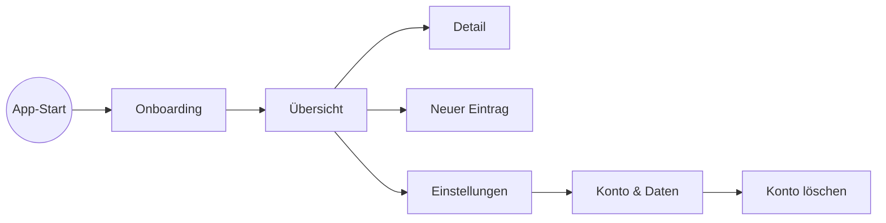

# Phase 7 – Screens & Navigation

> Kurz: Welche Bildschirme gibt es und wie hängen sie zusammen?

| | |
|---|---|
| **Ziel** | Vollständige Screen-Liste und Navigationsstruktur |
| **Ergebnis** | `projekte/<slug>/07-screens.md` |
| **Visual** | Screen-Map als Mermaid |
| **Dauer** | ca. 10–15 Minuten |
| **Überspringen** | Lite-Modus (wird dann in Phase 8 mit erledigt) |

## Für Einsteiger erklärt

Aus den Flows ergeben sich die **Bildschirme** (Screens) der App. Die **Screen-Map** ist wie ein Grundriss: Sie zeigt alle Räume und die Türen dazwischen. So sieht man sofort, ob etwas fehlt oder ob ein Nutzer sich verlaufen könnte.

## Fragen

**Q1 – Die KI zeigt eine Screen-Liste, abgeleitet aus den Flows. Fehlt etwas oder ist etwas doppelt?**

**Q2 – Welche Navigation passt?**
- a) **Untere Tab-Leiste** mit 3–5 Bereichen (typisch fürs Handy) **(Empfehlung bei Mobile)**
- b) **Seitenmenü** (gut bei vielen Bereichen, Desktop)
- c) **Ein Startbildschirm mit Kacheln**
- d) Weiß nicht – schlag vor

**Q3 – Welche 3–5 Bereiche sind die wichtigsten** (für die Hauptnavigation)?

**Q4 – Gibt es Bereiche, die nur bestimmte Nutzer sehen dürfen?** (Admin, Premium, Trainer …)

## Was die KI selbst ergänzen soll

- Screen-Liste mit: Name, Zweck, wer darf ihn sehen, von wo erreichbar, wichtigste Elemente.
- Pflicht-Screens prüfen: Login/Registrierung, Passwort vergessen, Einstellungen, Profil, Konto löschen, Impressum, Datenschutz, 404/Fehlerseite.
- Screen-Map als Mermaid.
- Tiefe prüfen: Kein wichtiges Ziel sollte mehr als 3 Taps vom Start entfernt sein. Hinweis, falls doch.

## Missbrauchs- und Sicherheitscheck

- Geschützte Screens: Notiere, dass **das Verstecken eines Menüpunkts keine Sicherheit ist** – der Server muss den Zugriff trotzdem prüfen (Phase 12/14).
- Admin-Bereich: eigene Route, nie über einen versteckten Button im normalen Frontend „gesichert“.

## Ergebnis-Dokument `07-screens.md`

````markdown
# Screens & Navigation

## Navigation
Typ: … | Hauptbereiche: …

## Screen-Liste
| ID | Screen | Zweck | Sichtbar für | Erreichbar von | Wichtigste Elemente | Flows |
|---|---|---|---|---|---|---|
| S01 | Start / Übersicht | … | eingeloggte Nutzer | Tab 1 | … | FL-01, FL-02 |

## Screen-Map

````

## Definition of Done
- [ ] Jeder Flow-Schritt hat einen Screen
- [ ] Pflicht-Screens vorhanden (soweit zutreffend)
- [ ] Sichtbarkeit pro Screen festgelegt
- [ ] Screen-Map erstellt

→ **Standard-Gate**
