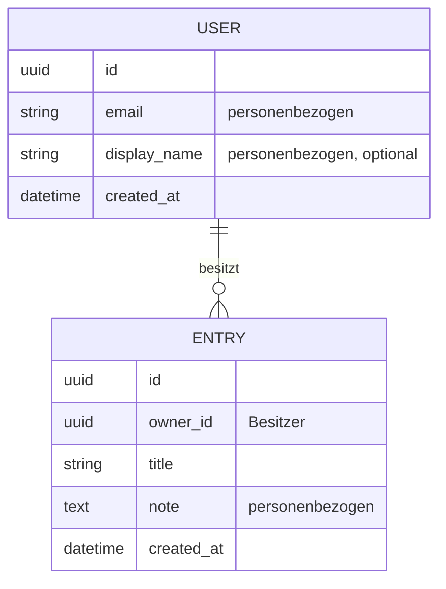

# Phase 11 – Daten & Datenklassifizierung

> Kurz: Welche Daten speichert die App, wie hängen sie zusammen – und wie schützenswert sind sie?

| | |
|---|---|
| **Ziel** | Datenmodell, Datenklassifizierung, Speicherdauer; Risikostufe überprüfen |
| **Ergebnis** | `projekte/<slug>/11-daten.md` |
| **Visual** | ER-Diagramm (Mermaid `erDiagram`) |
| **Dauer** | ca. 20 Minuten |
| **Überspringen** | nie |

## Für Einsteiger erklärt

Jede App speichert Daten: Nutzer, Einträge, Fotos, Einstellungen. Das **Datenmodell** beschreibt, welche „Dinge“ es gibt und wie sie zusammenhängen (ein Nutzer hat viele Einträge). Die **Datenklassifizierung** sortiert jedes Datenfeld nach Schutzbedarf. Das ist die Grundlage für Sicherheit und Datenschutz: Was nicht gespeichert wird, kann auch nicht gestohlen werden.

## Fragen

**Q1 – Die KI zeigt einen Entwurf der Datenobjekte** (abgeleitet aus Funktionen und Screens), z. B. Nutzer, Eintrag, Kategorie, Datei. **Passt das? Fehlt etwas?**

**Q2 – Welche Felder braucht jedes Objekt wirklich?** (KI schlägt Felder vor und markiert, welche **optional** oder **verzichtbar** sind – Datensparsamkeit.)

**Q3 – Laden Nutzer Dateien hoch?** (Fotos, PDFs, Audio)
- a) Nein
- b) Ja – welche Art und wie groß ungefähr?

**Q4 – Wie lange sollen Daten aufbewahrt werden?**
- a) Bis der Nutzer sie löscht
- b) Automatisch nach einer Frist löschen (welche?)
- c) Weiß nicht – schlag vor

**Q5 – Muss die App offline funktionieren?** (Daten lokal auf dem Gerät speichern und später synchronisieren.)
- a) Nein, immer online
- b) Nur lesen offline
- c) Lesen und schreiben offline

**Q6 – Gibt es Inhalte, die du (als Betreiber) bereitstellst?** (Texte, Übungen, Rezepte, Kataloge) – Wer pflegt sie, wie oft ändern sie sich?

## Was die KI selbst ergänzen soll

- **Datenklassifizierung** für jedes Feld:

| Klasse | Bedeutung | Beispiele |
|---|---|---|
| **Öffentlich** | Darf jeder sehen | App-Inhalte, öffentliche Profile |
| **Intern** | Nicht schlimm, aber nicht öffentlich | Einstellungen, Zeitstempel |
| **Personenbezogen** | Bezieht sich auf eine Person (DSGVO) | Name, E-Mail, IP-Adresse, Nutzerinhalte |
| **Besonders schützenswert** | Art. 9 DSGVO oder großer Schaden bei Leak | Gesundheit, Religion, Biometrie, sexuelle Orientierung, Standortverläufe, Finanzdaten, Ausweisnummern, Kinderdaten |
| **Geheim (technisch)** | Darf niemals ausgegeben werden | Passwort-Hashes, Tokens, API-Schlüssel |

- **Risikostufe überprüfen** anhand der Tabelle in `AGENTS.md` Abschnitt 5: Kommt „besonders schützenswert“ vor (z. B. Gesundheit, genauer oder dauerhafter Standort, Finanzdaten über reine Bezahlung hinaus) → Stufe 3. Reine Bezahlung über einen Anbieter oder grober, nicht gespeicherter Standort heben die Stufe **nicht** automatisch auf 3. Änderung in `PROJECT_STATE.md` und `ENTSCHEIDUNGEN.md` dokumentieren und dem Nutzer erklären.
- Jedes Objekt bekommt ein **Besitzerfeld** (z. B. `owner_id`), falls es einem Nutzer gehört. Das ist die Grundlage gegen den „ID in der URL ändern“-Angriff (Phase 12/14).
- IDs als **UUID** statt fortlaufender Zahl vorschlagen (erschwert Raten – ist aber **kein** Ersatz für Berechtigungsprüfung).
- Zeitstempel (`created_at`, `updated_at`) und ggf. Soft-Delete vs. echtes Löschen begründen. Hinweis: DSGVO-Löschung heißt **wirklich löschen** (inkl. Dateien), nicht nur verstecken.
- Datenfluss-Liste: Welche Daten gehen an **welche externen Dienste** (Hosting, E-Mail-Versand, Analytics, KI-API)? → Grundlage für Phase 16.
- Bei Offline: Welche Daten liegen auf dem Gerät, und sind sie dort geschützt? → Phase 14.

## Missbrauchs- und Sicherheitscheck

- Wird etwas gespeichert, das **nicht gebraucht** wird? → streichen.
- Werden sensible Daten in **URLs, Logs oder Dateinamen** stehen? → vermeiden.
- Dateiuploads: erlaubte Typen und Maximalgröße festlegen; Dateien nicht öffentlich zugänglich speichern.
- Freitextfelder können sensible Daten enthalten, auch wenn das nicht geplant ist (z. B. Notizen zur Gesundheit) → Klassifizierung entsprechend hoch ansetzen.

## Ergebnis-Dokument `11-daten.md`

````markdown
# Daten & Inhalte

## Datenmodell


## Datenklassifizierung
| Objekt.Feld | Klasse | Pflicht? | Begründung | Aufbewahrung |
|---|---|---|---|---|

## Dateien
…

## Offline
…

## Datenflüsse zu externen Diensten
| Daten | Dienst | Zweck | Ort (EU/USA) |
|---|---|---|---|

## Risikostufe
Bestätigt / geändert auf … weil …
````

## Definition of Done
- [ ] Alle Objekte und Felder erfasst, unnötige gestrichen
- [ ] Jedes Feld klassifiziert
- [ ] Besitzerfelder für nutzerbezogene Daten
- [ ] Aufbewahrung und Löschung geklärt
- [ ] Risikostufe überprüft
- [ ] ER-Diagramm erstellt

→ **Standard-Gate**
