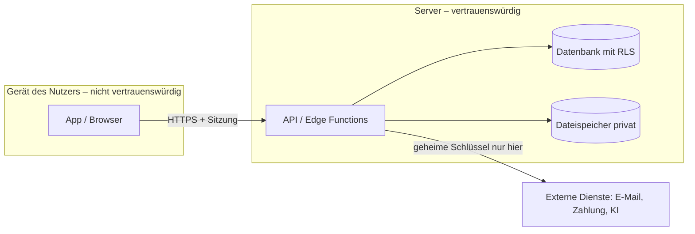

# Phase 13 – Tech-Stack & Architektur

> Kurz: Mit welchen Werkzeugen wird gebaut, und wie hängen die Teile zusammen?

| | |
|---|---|
| **Ziel** | Begründete Technologie-Auswahl, Architektur-Skizze, Umgebungen |
| **Ergebnis** | `projekte/<slug>/13-architektur.md` |
| **Visual** | Architektur-Diagramm (Mermaid) |
| **Dauer** | ca. 15–20 Minuten |
| **Überspringen** | nie |

## Für Einsteiger erklärt

Der **Tech-Stack** sind die Werkzeuge, aus denen die App gebaut wird: Frontend (was der Nutzer sieht), Backend (Logik auf dem Server), Datenbank (wo Daten liegen) und Hosting (wo alles läuft). Für Einsteiger gilt: **Bewährtes und Verbreitetes** wählen. KI-Coding-Tools kennen populäre Technologien am besten, und es gibt mehr Hilfe im Netz. Exotische Technik ist nur dann sinnvoll, wenn es einen klaren Grund gibt.

## Fragen

**Q1 – Hast du Vorlieben oder schon Erfahrung mit bestimmten Tools?** (z. B. React, Supabase, Firebase, Next.js, Flutter) – oder: „Weiß nicht, schlag vor.“

**Q2 – Welches Coding-Tool willst du zum Bauen verwenden?**
- a) Claude Code
- b) Cursor / Windsurf
- c) Lovable / Bolt / v0 (Browser-Baukasten)
- d) GitHub Copilot
- e) Weiß nicht

**Q3 – Wie wichtig sind dir monatliche Kosten am Anfang?**
- a) So nah wie möglich an 0 € (Gratis-Stufen nutzen)
- b) Bis ca. 20–50 € / Monat ok
- c) Egal, Qualität zählt

**Q4 – Wo sollen die Daten liegen?**
- a) Möglichst in der EU **(Empfehlung bei personenbezogenen Daten)**
- b) Egal

**Q5 – Die KI stellt 2 Stack-Optionen mit Vor- und Nachteilen vor. Welche nimmst du?**

## Was die KI selbst ergänzen soll

Wähle **2 passende Optionen** anhand von Plattform (Phase 0), Offline-Bedarf (Phase 11), Risikostufe, Kosten und Erfahrung. Typische Einsteiger-Kombinationen (nur Beispiele – aktuelle Konditionen, Preise und Regionen vor der Entscheidung prüfen):

| Szenario | Frontend | Backend / Daten | Hosting | Hinweis |
|---|---|---|---|---|
| Web-App / PWA mit Konten | React + Vite oder Next.js, TypeScript | Supabase (Postgres, Auth, Storage, Row Level Security) | Vercel / Netlify / Cloudflare | EU-Region wählbar; Row Level Security **Pflicht** |
| Native App iOS + Android | React Native (Expo) oder Flutter | Supabase oder Firebase | App Stores | Store-Gebühren und Prüfprozesse |
| Rein lokale App ohne Konten | React PWA | Daten im Browser (IndexedDB) | statisches Hosting | kein Server = weniger Angriffsfläche, aber kein Sync |

- Für jede Option: **Warum passt sie**, was kostet sie ungefähr, was sind die **Grenzen** und **Lock-in-Risiken**.
- **TypeScript** statt JavaScript empfehlen (weniger Fehler, KI-Tools arbeiten zuverlässiger).
- **Umgebungen** festlegen: Entwicklung (lokal), Test/Staging (optional, bei Stufe 2–3 empfohlen), Produktion – mit **getrennten Datenbanken und Schlüsseln**.
- **Versionsverwaltung** mit Git/GitHub als Pflicht (Rückgängig machen, Sicherung).
- Architektur-Diagramm mit allen Komponenten und **Vertrauensgrenzen** (wo Daten vom Gerät zum Server gehen – dort wird geprüft).
- Ehrlich benennen, wenn ein Wunsch-Stack schlecht passt (z. B. „Firebase ohne Sicherheitsregeln ist ein offenes Scheunentor“, „Browser-Baukasten erzeugt schnell Code, aber Zugriffsschutz musst du selbst prüfen“).

## Missbrauchs- und Sicherheitscheck

- **Wo laufen geheime Operationen?** (Zahlung, KI-API, E-Mail-Versand, Admin-Funktionen) → immer serverseitig (Backend / Edge Function), nie im Browser oder in der App.
- Nutzt die Datenbank einen öffentlich sichtbaren Schlüssel (z. B. Supabase Publishable/Anon Key, Firebase Config)? → Dann muss **Row Level Security / Security Rules** von Anfang an aktiv sein. Ohne das ist die Datenbank faktisch offen.
- Abhängigkeiten: Nur verbreitete, gepflegte Pakete; jede zusätzliche Bibliothek ist ein Risiko.

## Ergebnis-Dokument `13-architektur.md`

````markdown
# Tech-Stack & Architektur

## Entscheidung
| Bereich | Wahl | Begründung | Alternative |
|---|---|---|---|
| Frontend | … | … | … |
| Backend | … | … | … |
| Datenbank | … | … | … |
| Auth | … | … | … |
| Hosting | … | … | … |
| Coding-Tool | … | … | … |

## Architektur


## Umgebungen
| Umgebung | Zweck | Datenbank | Schlüssel |
|---|---|---|---|

## Kosten-Schätzung (grob, prüfen)
…

## Risiken & Lock-in
…
````

## Definition of Done
- [ ] Stack gewählt und begründet
- [ ] Architektur-Diagramm mit Vertrauensgrenze
- [ ] Umgebungen und Schlüsseltrennung festgelegt
- [ ] Ort der Datenspeicherung geklärt

→ **Standard-Gate**
