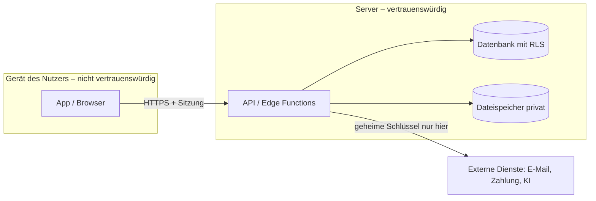

# Phase 13 – Tech-Stack & Architektur

> Kurz: Mit welchen Werkzeugen wird gebaut, und wie hängen die Teile zusammen?

| | |
|---|---|
| **Ziel** | Begründete Technologie-Auswahl, Architektur-Skizze, Umgebungen |
| **Ergebnis** | `projekte/<slug>/13-architektur.md` |
| **Visual** | Architektur-Diagramm (Mermaid) |
| **Dauer** | ca. 15–20 Minuten |
| **Überspringen** | nie |

## Für Einsteiger erklärt

Der **Tech-Stack** sind die Werkzeuge, aus denen die App gebaut wird: Frontend (was der Nutzer sieht), Backend (Logik auf dem Server), Datenbank (wo Daten liegen) und Hosting (wo alles läuft). Für Einsteiger gilt: **Bewährtes und Verbreitetes** wählen. KI-Coding-Tools kennen populäre Technologien am besten, und es gibt mehr Hilfe im Netz. Exotische Technik ist nur dann sinnvoll, wenn es einen klaren Grund gibt.

Auch die **Art der App** ist eine Technik-Entscheidung: Eine Web-App läuft im Browser, eine Handy-App wird über Stores verteilt, ein Desktop-Programm wird installiert, eine Browser-Erweiterung sitzt im Browser, ein Spiel braucht oft eine eigene Engine, ein Bot lebt in einem Chat-Dienst, eine reine API hat gar keine Oberfläche. Jede Art hat eigene Stolpersteine bei Sicherheit, Veröffentlichung und Recht. Welche Art zu deiner Idee passt und was sich jeweils ändert, steht in `guides/plattformen.md`; wie die Veröffentlichung in den Stores abläuft, in `guides/appstore-veroeffentlichung.md`; wie du ausliefern kannst, in `guides/auslieferung.md`.

## Fragen

> **Vorab für die KI:** Hole die Machbarkeits-Ampel aus Phase 5. Behandle zuerst alle 🔴-Funktionen und danach die 🟡-Funktionen: Ist sie mit dem gewählten Stack, der Plattform und dem Budget machbar? Sage dem Nutzer offen, wenn eine Muss-Funktion dadurch teurer wird, sich ändern muss oder entfällt – das kann Phase 5, 6, 7 und 8 betreffen (Abhängigkeitstabelle in `AGENTS.md` Abschnitt 10). Mockups aus Phase 8 sind Wünsche, keine Zusagen.

**Q1 – Hast du Vorlieben oder schon Erfahrung mit bestimmten Tools?** (z. B. React, Supabase, Firebase, Next.js, Flutter) – oder: „Weiß nicht, schlag vor.“

**Q2 – Welches Coding-Tool willst du zum Bauen verwenden?**
- a) Claude Code
- b) Cursor / Windsurf
- c) Lovable / Bolt / v0 (Browser-Baukasten)
- d) GitHub Copilot
- e) Weiß nicht

**Q3 – Wie wichtig sind dir monatliche Kosten am Anfang?**
- a) So nah wie möglich an 0 € (Gratis-Stufen nutzen)
- b) Bis ca. 20–50 € / Monat ok
- c) Egal, Qualität zählt

**Q4 – Wo sollen die Daten liegen?**
- a) Möglichst in der EU **(Empfehlung bei personenbezogenen Daten)**
- b) Egal

**Q5 – Die KI stellt 2–3 Stack-Optionen in einer Bewertungsmatrix vor. Welche nimmst du?**

### Plattformabhängige Fragen (Q6–Q17)

> Stelle diese Fragen **vor Q5**, denn sie bestimmen, welche Optionen in der Bewertungsmatrix stehen. Q6 gilt immer; Q7–Q17 nur, wenn die Bedingung in Klammern zutrifft. Frage jeweils nur **eine** Sache, in der Reihenfolge der Nummern. Grundlage ist `guides/plattformen.md`. Jede Frage bietet auch „Weiß ich nicht – schlag du etwas vor“ an; in dem Fall triffst du eine begründete Annahme `[ANNAHME A-…]`.

**Q6 – Welche Art von App ist es genau?** (Bestätigung bzw. Feinschliff der Antwort aus Phase 0)
- a) Web-App oder PWA **(Empfehlung für den Einstieg, wenn keine tiefen Systemfunktionen nötig sind)**
- b) Native App für iOS und/oder Android
- c) Cross-Platform-App (ein Code für mehrere Systeme)
- d) Desktop-Programm
- e) Browser-Erweiterung
- f) Spiel
- g) App für Smartwatch oder anderes Wearable
- h) Bot oder Chat-Integration
- i) Reine API / Backend-Dienst ohne eigene Oberfläche
- j) Weiß ich nicht – schlag du etwas vor

**Q7 (nur bei b, c, d oder f – Handy, Desktop oder Spiel) – Soll die App in einem Store angeboten werden?**
- a) Nein, zuerst nur als Web-App/PWA oder über direkte Einladung **(Empfehlung für den ersten Test)**
- b) Ja, in einem Store (Details und Kosten: `guides/appstore-veroeffentlichung.md`)
- c) Weiß ich nicht – schlag du etwas vor

**Q8 (nur bei b, c oder g) – Welche Systeme zuerst?**
- a) Erst eines (iOS **oder** Android) **(Empfehlung bei kleinem Team)**
- b) Beide gleichzeitig
- c) Weiß ich nicht – schlag du etwas vor

**Q9 (nur bei d – Desktop) – Für welche Betriebssysteme?**
- a) Windows
- b) macOS
- c) Linux
- d) Mehrere (bitte nennen)
- e) Weiß ich nicht – schlag du etwas vor

**Q10 (nur bei d – Desktop) – Wie sollen Updates zu den Nutzern kommen?**
- a) Automatisches, **signiertes** Update **(Empfehlung)** – Hinweis: Signierschlüssel müssen geschützt werden
- b) Nutzer laden neue Versionen selbst von der Webseite herunter
- c) Nur über einen Store
- d) Weiß ich nicht – schlag du etwas vor

**Q11 (nur bei e – Erweiterung) – Für welchen Browser zuerst?**
- a) Chrome (und verwandte Browser) **(Empfehlung, wenn du keinen anderen Wunsch hast; Verbreitung und Regeln der Browser-Stores vor der Entscheidung prüfen `[PRÜFEN]`)**
- b) Firefox
- c) Safari
- d) Edge
- e) Weiß ich nicht – schlag du etwas vor

**Q12 (nur bei e – Erweiterung) – Auf welche Webseiten muss die Erweiterung zugreifen?**
- a) Nur auf eine oder wenige bestimmte Seiten **(Empfehlung: kleinste nötige Berechtigung)**
- b) Auf alle Webseiten (strengere Prüfung, mehr Misstrauen der Nutzer)
- c) Nur auf Anforderung des Nutzers für die gerade offene Seite
- d) Weiß ich nicht – schlag du etwas vor

**Q13 (nur bei f – Spiel) – Wer entscheidet über Ergebnisse, Punkte und Käufe?**
- a) Rein lokal auf dem Gerät (Einzelspieler ohne Wettbewerb und ohne echtes Geld)
- b) Ein Server prüft oder berechnet Ergebnisse und Käufe **(Empfehlung, sobald es Bestenlisten, Mehrspieler oder Käufe gibt)**
- c) Weiß ich nicht – schlag du etwas vor

**Q14 (nur bei f – Spiel) – Welche Spiel-Engine bzw. Grundlage ist vorgesehen?**
- a) Ich habe schon Erfahrung mit einer bestimmten Engine (bitte nennen)
- b) Reine Web-Technik (läuft im Browser)
- c) Eine verbreitete Engine mit viel Lernmaterial – die KI nennt 2–3 Beispiele samt Lizenz- und Kostenhinweis `[PRÜFEN]` **(Empfehlung)**
- d) Weiß ich nicht – schlag du etwas vor

**Q15 (nur bei g – Wearable) – Soll die Uhr-App eigenständig laufen?**
- a) Nein, sie ergänzt die Handy-App und zeigt nur das Wichtigste **(Empfehlung)**
- b) Ja, eigenständig
- c) Weiß ich nicht – schlag du etwas vor

**Q16 (nur bei h – Bot) – In welchem Chat-Dienst soll der Bot laufen?**
- a) Slack
- b) Discord
- c) Telegram
- d) Anderer (bitte nennen)
- e) Weiß ich nicht – schlag du etwas vor

**Q17 (nur bei i – API) – Wer soll die API nutzen?**
- a) Nur meine eigenen Programme (intern)
- b) Externe Kunden oder Entwickler (eigene Zugangsschlüssel pro Kunde, Rate Limits, Dokumentation nötig) **(Hinweis: deutlich mehr Aufwand für Betrieb und Sicherheit)**
- c) Weiß ich nicht – schlag du etwas vor

## Was die KI selbst ergänzen soll

Wähle **2–3 passende Optionen** anhand von Plattform (Phase 0), Offline-Bedarf (Phase 11), Risikostufe, Kosten und Erfahrung und bewerte **alle mit denselben Kriterien** in einer Matrix (1 = schlecht, 5 = sehr gut, jede Zahl mit Halbsatz Begründung):

| Kriterium | Gewicht | Option A | Option B | Option C |
|---|---|---|---|---|
| Monatliche Kosten (Start / bei Wachstum) | | | | |
| Betriebsaufwand (Updates, Server, Backups) | | | | |
| Datenschutz (EU-Speicherort, AVV) | | | | |
| Sicherheit „ab Werk“ (Auth, Zugriffsregeln, Header) | | | | |
| Eignung für KI-Coding-Tools / Lernkurve | | | | |
| Entwicklungszeit bis MVP | | | | |
| Skalierung | | | | |
| Lock-in / Ausstiegsaufwand | | | | |
| **Gewichtete Summe** | | | | |

- Gewichte mit dem Nutzer abstimmen (Einsteiger: Vorschlag machen, z. B. Sicherheit ab Werk und Betriebsaufwand hoch gewichten).
- Preise, Gratis-Grenzen und Regionen mit Beleg in `QUELLEN.md` (`[Q-…]`) oder als Annahme markieren.
- Die Entscheidung kommt als `E-…` mit verworfenen Optionen in `ENTSCHEIDUNGEN.md` (Architekturentscheidung).
- Die Matrix ist eine Entscheidungshilfe, kein Automat: Wenn die Summe knapp ist, sag das und nenne das ausschlaggebende Kriterium.

Typische Einsteiger-Kombinationen (nur Beispiele – aktuelle Konditionen, Preise und Regionen vor der Entscheidung prüfen):

| Szenario | Frontend | Backend / Daten | Hosting | Hinweis |
|---|---|---|---|---|
| Web-App / PWA mit Konten | React + Vite oder Next.js, TypeScript | Supabase (Postgres, Auth, Storage, Row Level Security) | Vercel / Netlify / Cloudflare | EU-Region wählbar; Row Level Security **Pflicht** |
| Native App iOS + Android | React Native (Expo) oder Flutter | Supabase oder Firebase | App Stores | Store-Gebühren und Prüfprozesse |
| Rein lokale App ohne Konten | React PWA | Daten im Browser (IndexedDB) | statisches Hosting | kein Server = weniger Angriffsfläche, aber kein Sync |
| Desktop-Programm | Web-Oberfläche in einem Desktop-Rahmen (z. B. Electron oder Tauri) oder systemeigen | lokal oder eigenes Backend | Eigene Webseite oder Store | Signierung, Update-Weg und Rechte-Trennung einplanen (`guides/plattformen.md`) |
| Browser-Erweiterung | Manifest V3 (HTML, CSS, TypeScript) | optional kleines Backend | Chrome Web Store o. Ä. | Berechtigungen minimal halten; Prüfzeiten beachten |
| Spiel | Engine oder reine Web-Technik | Server für Ergebnisse, Käufe, Mehrspieler | Stores, PC-Plattformen oder Web | Server-Autorität, Altersfreigabe, Store-Käufe |
| Bot / Chat-Integration | Kein eigenes Frontend | Webhook-Server (z. B. Edge Function) + Datenbank | Hosting mit öffentlicher Adresse | Signaturprüfung und Token-Schutz |
| Reine API | – | API-Server + Datenbank | Hosting mit HTTPS | Schlüssel pro Kunde, Rate Limits, Dokumentation |

- Für jede Option: **Warum passt sie**, was kostet sie ungefähr, was sind die **Grenzen** und **Lock-in-Risiken**.
- **TypeScript** statt JavaScript empfehlen (weniger Fehler, KI-Tools arbeiten zuverlässiger).
- **Umgebungen** festlegen: Entwicklung (lokal), Test/Staging (optional, bei Stufe 2–3 empfohlen), Produktion – mit **getrennten Datenbanken und Schlüsseln**.
- **Versionsverwaltung** mit Git/GitHub als Pflicht (Rückgängig machen, Sicherung).
- Architektur-Diagramm mit allen Komponenten und **Vertrauensgrenzen** (wo Daten vom Gerät zum Server gehen – dort wird geprüft).
- **Plattformabhängige Ergänzungen** (Grundlage: `guides/plattformen.md`): Je nach Antwort auf Q6 ergänzt du die Matrix und das Ergebnis-Dokument um die Punkte der folgenden Tabelle. Aussagen zu Stores, Gebühren und Richtlinien nur mit Beleg in `QUELLEN.md` oder als `[PRÜFEN]`/Annahme (Quellen: `guides/appstore-veroeffentlichung.md`). Konkrete Sicherheitswerte stehen nur in `security/standardwerte.md`.

| Plattform (Q6) | Zusätzliche Matrix-Kriterien | Zusätzliche Architektur-Punkte | Verweis |
|---|---|---|---|
| a Web/PWA | Offline-Bedarf, Unterstützung der benötigten Browser-Funktionen auf echten Geräten | Hosting + Domain + Security-Header; Aktualisierung des Zwischenspeichers (Service Worker) | `guides/plattformen.md` Abschnitt 3 |
| b Native | Zugriff auf benötigte Systemfunktionen, Aufwand je System, Store-Pflichten | Backend für geheime Schlüssel und Kauf-Prüfung; Umgang mit alten App-Versionen; sicherer Schlüsselspeicher | Abschnitt 4, `guides/appstore-veroeffentlichung.md` |
| c Cross-Platform | Reife der benötigten Zusatzpakete, Lock-in beim Werkzeug, Aktualisierbarkeit | wie b; zusätzlich Prüfung der Pakete (`guides/lieferkette.md`) | Abschnitt 5 |
| d Desktop | Update- und Signierungsweg, Größe/Ressourcen, Dateizugriff, Pflege der enthaltenen Browser-Engine | Rechte-Trennung zwischen Oberfläche und Systemzugriff; Update-Server; Schlüsselverwaltung für Signierung | Abschnitt 6, `guides/auslieferung.md` |
| e Erweiterung | Browser-Unterstützung, Berechtigungsumfang, Prüfaufwand im Store | Manifest mit minimalen Berechtigungen; kein nachgeladener Code; Server nur für Teures/Geheimes | Abschnitt 7 |
| f Spiel | Engine-Lizenz und -Kosten, Zielplattformen, Leistung, Lernkurve | Server-Autorität für Ergebnisse und Käufe; Moderation und Meldewege bei Mehrspieler; Altersfreigabe | Abschnitt 8 |
| g Wearable | Akku, Bildschirmgröße, Sensorzugriff, Kopplung mit dem Handy | Datenfluss Uhr ↔ Handy ↔ Server; Gesundheitsdaten mit besonderem Schutz | Abschnitt 9 |
| h Bot | Plattform-Bindung (Ausstieg), Webhook-/Verbindungsart, Rechte des Bots | Signaturprüfung für Webhooks; Token-Verwaltung; Mandantentrennung nach Arbeitsbereich | Abschnitt 10 |
| i API | Dokumentation, Versionierung, Kundenverwaltung, Abrechnungszähler | Schlüssel-Verwaltung mit Rechten und Widerruf; Rate Limits pro Schlüssel und IP; Status- und Betriebskonzept | Abschnitt 11 |

- Wenn die Plattform **nicht** Web ist, ergänze in der Beispiel-Tabelle der Einsteiger-Kombinationen ein **eigenes Szenario** für sie (nur als Beispiel, Preise und Konditionen prüfen).
- Gib jeder gewählten Plattform eine kurze **Veröffentlichungsweg-Zeile** (Wo? Mit welchen Konten? Mit welcher Prüfung?) und trage die Folgen für spätere Phasen in `PROJECT_STATE.md` ein (`guides/plattformen.md` Abschnitt 12), z. B. „Phase 17: Store-Provision berücksichtigen“.
- Ehrlich benennen, wenn ein Wunsch-Stack schlecht passt (z. B. „Firebase ohne Sicherheitsregeln ist ein offenes Scheunentor“, „Browser-Baukasten erzeugt schnell Code, aber Zugriffsschutz musst du selbst prüfen“).

## Missbrauchs- und Sicherheitscheck

- **Wo laufen geheime Operationen?** (Zahlung, KI-API, E-Mail-Versand, Admin-Funktionen) → immer serverseitig (Backend / Edge Function), nie im Browser oder in der App.
- Nutzt die Datenbank einen öffentlich sichtbaren Schlüssel (z. B. Supabase Publishable/Anon Key, Firebase Config)? → Dann muss **Row Level Security / Security Rules** von Anfang an aktiv sein. Ohne das ist die Datenbank faktisch offen.
- Abhängigkeiten: Nur verbreitete, gepflegte Pakete; jede zusätzliche Bibliothek ist ein Risiko.
- **Plattform-Fallen:** Die typischen Sicherheitsfallen der gewählten Plattform stehen in `guides/plattformen.md` (jeweils unter „Typische Sicherheitsfallen“, mit Verweisen auf Regelnummern in `security/regeln-fuer-ki.md`). Gehe sie für die gewählte Plattform durch und übernimm die zutreffenden in das Bedrohungsmodell von Phase 14 (z. B. Desktop: manipuliertes Update; Erweiterung: zu breite Berechtigungen; Spiel: gefälschte Ergebnisse; Bot: gefälschte Webhook-Aufrufe).
- **Alles, was ausgeliefert wird, ist lesbar:** Geheimnisse gehören nie in App-Paket, Programm, Erweiterung oder Spiel-Client (Regel 1.1), egal wie „versteckt“.
- **Signierschlüssel und Entwicklerkonten** (Stores, Update-Server) sind Hochwertziele: Zwei-Faktor-Schutz, Schlüssel nicht im Repository, Wiederherstellungsplan (`guides/appstore-veroeffentlichung.md`, Abschnitt 12).

## Ergebnis-Dokument `13-architektur.md`

````markdown
# Tech-Stack & Architektur

## Entscheidung
| Bereich | Wahl | Begründung | Alternative |
|---|---|---|---|
| Frontend | … | … | … |
| Backend | … | … | … |
| Datenbank | … | … | … |
| Auth | … | … | … |
| Hosting | … | … | … |
| Coding-Tool | … | … | … |
| Plattform / Veröffentlichung | … | … | … |

## Plattform
| Punkt | Festlegung |
|---|---|
| Art der App (Q6) | Web/PWA · Native · Cross-Platform · Desktop · Erweiterung · Spiel · Wearable · Bot · API |
| Zielsysteme (Q8, Q9, Q11, Q16) | … |
| Store/Veröffentlichungsweg (Q7) | … (Konten, Kosten mit [Q-…] oder [PRÜFEN], Prüfzeit) |
| Besonderheiten nach `guides/plattformen.md` | … (z. B. Update-Weg Q10, Berechtigungen Q12, Server-Autorität Q13, Kopplung Q15, Webhook-Verfahren, Kundenverwaltung Q17) |
| Phasen, die sich ändern/entfallen | … (auch in `PROJECT_STATE.md` vermerkt) |
| Architekturentscheidung | E-… |

## Architektur


## Umgebungen
| Umgebung | Zweck | Datenbank | Schlüssel |
|---|---|---|---|

## Bewertungsmatrix
(Tabelle mit allen Optionen, Gewichten und Begründungen)

## Kosten-Schätzung (grob, mit [Q-…] belegt oder als Annahme)
…

## Risiken & Lock-in
…
````

## Definition of Done
- [ ] 2–3 Optionen in der Bewertungsmatrix verglichen; Stack gewählt und als `E-…` dokumentiert
- [ ] Architektur-Diagramm mit Vertrauensgrenze
- [ ] Umgebungen und Schlüsseltrennung festgelegt
- [ ] Ort der Datenspeicherung geklärt
- [ ] Art der App bestätigt (Q6); bei Nicht-Web-Plattformen die zugehörigen Zusatzfragen beantwortet und die Zusatzpunkte aus `guides/plattformen.md` im Dokument berücksichtigt
- [ ] Veröffentlichungsweg (Store, Download, Hosting) festgelegt; Kosten und Regeln mit Quelle oder `[PRÜFEN]`
- [ ] Plattformtypische Sicherheitsfallen durchgegangen und für Phase 14 vorgemerkt
- [ ] Folgen für spätere Phasen (z. B. 15, 16, 17, 23) in `PROJECT_STATE.md` vermerkt

→ **Standard-Gate**
