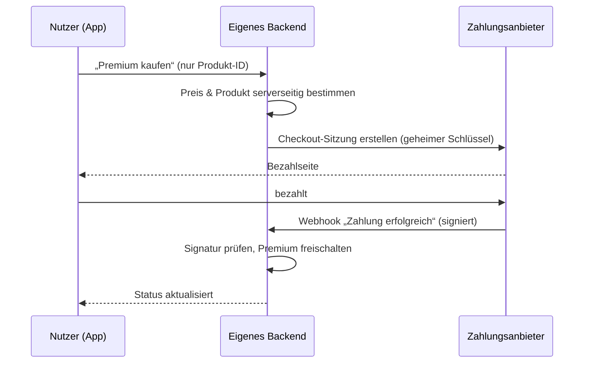

# Phase 15 – Login, Zahlung & Integrationen

> Kurz: Welche fremden Dienste bindet die App an – und wie genau?

| | |
|---|---|
| **Ziel** | Konkrete Auswahl von Login-, Zahlungs- und Drittanbietern inkl. Datenflüssen |
| **Ergebnis** | `projekte/<slug>/15-integrationen.md` |
| **Visual** | Sequenzdiagramm für Login und ggf. Zahlung (Mermaid) |
| **Dauer** | ca. 15 Minuten |
| **Überspringen** | Ohne Konten: Teil Login entfällt. Ohne Zahlung: Teil Zahlung entfällt. Lite-Modus: optional |

## Für Einsteiger erklärt

Die wenigsten Apps machen alles selbst. Login, Bezahlung, E-Mail-Versand, Karten oder KI kommen meist von spezialisierten Anbietern. Das ist gut – die können das sicherer und billiger. Aber jeder Anbieter bekommt Daten, kostet Geld und kann ausfallen. Deshalb wählen wir bewusst aus.

## Fragen

### Login (falls Konten)
**Q1 – Die Login-Methode wurde in Phase 14 gewählt. Welche Anmeldewege sollen angeboten werden?** (Mehrfachauswahl)
- a) E-Mail + Passwort
- b) Magic Link (E-Mail-Link)
- c) Mit Google anmelden
- d) Mit Apple anmelden (Hinweis: Bietet eine iOS-App andere Social-Logins an, verlangt Apple in der Regel auch „Mit Apple anmelden“ – aktuelle Richtlinie prüfen)
- e) Passkeys

### Zahlung (falls vorgesehen)
**Q2 – Was wird bezahlt?**
- a) Einmalkauf
- b) Abo (monatlich / jährlich)
- c) Einzelne Käufe in der App (z. B. Inhalte, Credits)
- d) Spenden / freiwillig

**Q3 – Wo wird bezahlt?**
- a) Im Web (z. B. Stripe, PayPal)
- b) In der iOS-/Android-App (App-Store-Kauf – für digitale Inhalte in Apps meist vorgeschrieben; Gebühren und aktuelle Regeln prüfen)
- c) Beides

### Weitere Dienste
**Q4 – Welche weiteren Dienste braucht die App?** (Die KI schlägt aus den Funktionen vor: E-Mail-Versand, Push-Benachrichtigungen, Karten, Kalender, KI-API, Dateispeicher, Analytics, Fehler-Tracking.) Welche davon wirklich im MVP?

## Was die KI selbst ergänzen soll

- Für jeden Dienst: Anbieter-Vorschlag, Zweck, **welche Daten** übertragen werden, **Ort** (EU/USA), grobe Kosten, **Gratis-Grenze**, Ausfallfolgen. Preise, Gratis-Grenzen, Regionen und Store-Regeln mit Beleg in `QUELLEN.md` (`[Q-…]`) oder als Annahme markieren.
- Datenschutzfreundliche Alternativen nennen (z. B. EU-Anbieter, selbst gehostetes Analytics ohne Cookies).
- **Sequenzdiagramm** für den Login-Ablauf und – falls vorhanden – den Zahlungsablauf inkl. Webhook.
- Abbildung der Sicherheitsregeln aus Phase 14 Abschnitt I auf die gewählten Dienste.

Beispiel Zahlungsablauf:

````markdown

````

## Missbrauchs- und Sicherheitscheck

- Social-Login: Konten nicht automatisch über unbestätigte E-Mail-Adressen verknüpfen (Kontoübernahme-Risiko).
- Zahlung: Freischaltung **nur** über verifizierten Webhook bzw. serverseitige Kaufbestätigung, nie über einen Parameter in der „Danke“-URL.
- Abos: Was passiert bei Kündigung, Rückbuchung, abgelaufener Karte? Rechte werden serverseitig entzogen.
- Jeder Dienst mit geheimem Schlüssel → nur serverseitig.
- Budget-Alarm bzw. harte Ausgabengrenze bei nutzungsabhängigen Diensten einrichten.

## Ergebnis-Dokument `15-integrationen.md`

```markdown
# Login, Zahlung & Integrationen

## Login
- Methoden: …
- Anbieter: …

## Zahlung
- Modell: …
- Anbieter: …
- Ablauf: (Sequenzdiagramm)

## Dienste
| Dienst | Anbieter | Zweck | Daten | Ort | Kosten / Gratis-Grenze | Schlüssel geheim? | Ausfallfolge |
|---|---|---|---|---|---|---|---|
```

## Definition of Done
- [ ] Alle Dienste mit Datenfluss und Ort erfasst
- [ ] Login- und ggf. Zahlungsablauf als Diagramm
- [ ] Freischaltung nur serverseitig
- [ ] Budget-Grenzen notiert

→ **Standard-Gate**
