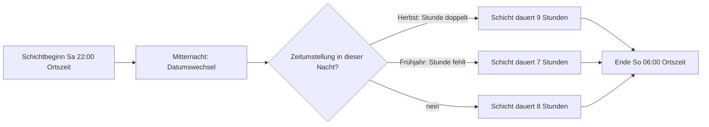

# Phase 18 – Performance, Offline & Benachrichtigungen

> Kurz: Wie schnell, zuverlässig und sparsam muss die App sein?

| | |
|---|---|
| **Ziel** | Messbare Qualitätsziele für Geschwindigkeit, Offline, Benachrichtigungen, Geräte |
| **Ergebnis** | `projekte/<slug>/18-qualitaetsziele.md` |
| **Visual** | Tabelle mit Zielwerten, Beispiel-Zeitstrahl zu Zeitzonen (Mermaid) |
| **Dauer** | ca. 15–20 Minuten |
| **Überspringen** | Lite-Modus (dann Standardwerte im Handoff) |

## Für Einsteiger erklärt

Neben dem, **was** die App kann (Funktionen), gibt es Anforderungen daran, **wie gut** sie es kann: Wie schnell lädt sie? Funktioniert sie im Funkloch? Leert sie den Akku? Schickt sie Benachrichtigungen? Solche Punkte heißen „nicht-funktionale Anforderungen“. Wenn man sie nicht festlegt, werden sie beim Bauen vergessen.

Drei Bereiche sind für Einsteiger besonders tückisch:

- **Messbare Geschwindigkeit:** „Soll schnell sein“ ist kein Ziel. Ein Ziel ist eine Zahl, die man messen kann. Für Webseiten und Web-Apps gibt es dafür die **Core Web Vitals** – drei Messwerte von Google, die erfassen, wie schnell Inhalte erscheinen, wie schnell die App auf Eingaben reagiert und ob das Layout beim Laden springt.
- **Zeit und Datum:** Dieselbe Uhrzeit bedeutet je nach Land, Jahreszeit und Gerät etwas anderes. Beispiele: Sommerzeit, ein Dienst, der über Mitternacht geht, oder Nutzer, die im Urlaub in einer anderen Zeitzone sind. Falsch behandelte Zeiten führen zu falschen Terminen, doppelten oder fehlenden Einträgen und schwer auffindbaren Fehlern.
- **Last und Wachstum:** Die App soll nicht zusammenbrechen, wenn plötzlich viele Menschen gleichzeitig kommen – aber du sollst auch nicht für Millionen Nutzer bauen, wenn du 50 hast. Hier reicht eine ehrliche Grobplanung.

## Fragen

**Q1 – Auf welchen Geräten muss die App gut laufen?**
- a) Aktuelle Smartphones
- b) Auch ältere / günstige Smartphones **(Empfehlung, wenn Zielgruppe breit ist)**
- c) Vor allem Desktop / Laptop
- d) Tablets

**Q2 – Offline-Verhalten** (aus Phase 11 bestätigen): Was genau muss ohne Internet gehen?

**Q3 – Soll die App Benachrichtigungen schicken?**
- a) Nein
- b) Ja, Push-Benachrichtigungen (Erinnerungen, Neuigkeiten)
- c) Ja, per E-Mail
- d) Beides
→ Wenn ja: Wofür genau, wie oft maximal, kann der Nutzer sie einzeln abschalten?

**Q4 – Wie viele Nutzer erwartest du im ersten Jahr ungefähr?** (Beeinflusst, ob Skalierung jetzt ein Thema ist – meist nicht.)

**Q5 – Soll die App messbare Performance-Ziele für Web-Leistungsmetriken (Core Web Vitals) bekommen?**
- a) Ja, mit den Standard-Zielwerten aus der Tabelle unten **(Empfehlung bei Web-App oder PWA)**
- b) Ja, aber mit strengeren oder lockereren eigenen Werten (dann bitte begründen)
- c) Nein, es ist keine Web-App (z. B. rein native App) – dann gelten stattdessen die Ziele für Start- und Reaktionszeit der App
- d) Weiß ich nicht – schlag du etwas vor

**Q6 – Wie wird die Performance gemessen?**
- a) Messwerte echter Nutzer (Feldmessung, z. B. über die Messdaten von Browser oder Hosting) und zusätzlich Testläufe im Labor **(Empfehlung)**
- b) Nur Testläufe im Labor (z. B. Lighthouse)
- c) Gar nicht, ich schaue nur subjektiv
- d) Weiß ich nicht – schlag du etwas vor
→ Hinweis: Feldmessung ist datenschutzrelevant, wenn sie einzelne Nutzer erkennbar macht (Phase 16). Aggregierte Werte genügen.

**Q7 – In welchen Zeitzonen leben deine Nutzer?**
- a) Alle in derselben Zeitzone (z. B. nur Deutschland)
- b) Überwiegend eine Zeitzone, einzelne Nutzer reisen oder wohnen woanders **(Empfehlung als vorsichtige Annahme, wenn unklar)**
- c) Weltweit verteilt
- d) Weiß ich nicht – schlag du etwas vor
→ Auch bei „alle in Deutschland“ muss die App mit der Sommerzeit-Umstellung umgehen.

**Q8 – Gibt es Zeiten oder Termine, die über Mitternacht gehen oder in Schichten geplant werden?** (z. B. Nachtschicht von 22:00 bis 06:00 Uhr, Training um 23:30 Uhr, Abos mit Verlängerung „um Mitternacht“)
- a) Nein
- b) Ja, Zeitspannen über Mitternacht müssen unterstützt werden
- c) Ja, und das Datum, dem ein Eintrag „gehört“, kann vom Kalendertag des Beginns abweichen (z. B. die Nachtschicht zählt zum Tag des Schichtbeginns)
- d) Weiß ich nicht – schlag du etwas vor

**Q9 – Welche Datums-, Zeit- und Zahlenformate sollen gelten?**
- a) Automatisch nach Sprach- und Regionseinstellung des Geräts bzw. Nutzers **(Empfehlung)**
- b) Fest für eine Region (z. B. immer Deutsch: 24-Stunden-Zeit, Datum Tag.Monat.Jahr, Komma als Dezimaltrennzeichen)
- c) Der Nutzer wählt in den Einstellungen
- d) Weiß ich nicht – schlag du etwas vor

**Q10 – Wann ist mit den meisten gleichzeitigen Nutzern zu rechnen?** (Lastspitzen, z. B. Schichtwechsel, Sendetermin, Aktion, Stichtag)
- a) Gleichmäßig über den Tag verteilt, kaum Spitzen
- b) Wenige, vorhersehbare Spitzen (Uhrzeit nennen)
- c) Unvorhersehbare Spitzen (z. B. durch Werbung oder Social Media)
- d) Weiß ich nicht – schlag du etwas vor

**Q11 – Wie wichtig ist dir, dass die App bei einer Lastspitze weiter funktioniert, statt langsamer zu werden oder auszufallen?**
- a) Kurzzeitige Verlangsamung ist okay, Hauptsache keine Daten gehen verloren **(Empfehlung beim MVP)**
- b) Sie soll auch bei Spitzen zuverlässig bleiben (mehr Aufwand und Kosten)
- c) Ausfall bei Spitzen wäre geschäftskritisch
- d) Weiß ich nicht – schlag du etwas vor

## Was die KI selbst ergänzen soll

Standard-Zielwerte (anpassbar). Die drei Web-Messwerte (LCP, INP, CLS) stammen aus der Dokumentation von Google (web.dev) und gelten dort als „gut“ [Q-18a, Q-18b]; alle anderen Zeilen sind Vorschläge der KI und deshalb Annahmen:

| Ziel | Standardwert |
|---|---|
| Erste Anzeige (Web, mobiles Netz) | sichtbarer Inhalt < 2,5 s (Largest Contentful Paint) |
| Reaktion auf Eingaben | < 200 ms (Interaction to Next Paint) |
| Layout springt nicht | Cumulative Layout Shift < 0,1 |
| Typische API-Antwort | < 500 ms `[ANNAHME]` |
| Lighthouse-Score (Web) | Performance und Accessibility ≥ 90 `[ANNAHME]` |
| App-/Bundle-Größe | so klein wie möglich; Bilder komprimiert, Lazy Loading `[ANNAHME]` |
| Verfügbarkeit | Best Effort beim MVP; Ausfall < 1 h tolerierbar `[ANNAHME]` |

- **Offline-Konzept**: was gecacht wird, wie Konflikte gelöst werden (z. B. „letzte Änderung gewinnt“ oder Nachfrage beim Nutzer), wie der Nutzer sieht, ob alles synchronisiert ist.
- **Benachrichtigungen**: Nur nach Zustimmung, sparsam, einzeln abschaltbar, mit Ruhezeiten.
- **Skalierung**: Ehrlich sagen, wenn sie für den MVP kein Thema ist („Für 500 Nutzer reicht die Gratis-Stufe; wir optimieren, wenn Zahlen es erfordern.“).

### Messbare Performance-Ziele (Web-Leistungsmetriken)

Die drei **Core Web Vitals** sind laut Google-Dokumentation `[Q-18a]`:

| Messwert | Was er misst | Ziel für „gut“ |
|---|---|---|
| **LCP** (Largest Contentful Paint) | Wie lange es dauert, bis der größte sichtbare Inhalt erscheint | innerhalb von 2,5 Sekunden nach Beginn des Ladens |
| **INP** (Interaction to Next Paint) | Wie schnell die Seite nach einer Eingabe (Tippen, Klicken) sichtbar reagiert | 200 Millisekunden oder weniger |
| **CLS** (Cumulative Layout Shift) | Wie stark sich Inhalte beim Laden unerwartet verschieben | 0,1 oder weniger |

- **Gemessen wird am 75. Perzentil** der Seitenaufrufe, getrennt nach Mobil und Desktop `[Q-18a]`. Das heißt: Drei von vier Aufrufen sollen das Ziel erreichen. Ein einzelner schneller Test auf deinem Rechner sagt wenig.
- INP gilt als stabiler Core Web Vital und ist der Nachfolger von First Input Delay (FID) `[Q-18b]`. Die Bereiche „verbesserungswürdig“ und „schlecht“ (INP: über 200 ms bis 500 ms bzw. darüber) sind in der Dokumentation zu INP genannt `[Q-18b]`; für LCP und CLS stehen sie nur in Grafiken von web.dev – bei Bedarf dort nachsehen `[PRÜFEN]`.
- **Lighthouse** ist ein Testwerkzeug im Chrome-Browser, das Seiten im Labor prüft. Ein Lighthouse-Ergebnis ist **keine Feldmessung** und kann von den Werten echter Nutzer abweichen. Der Zielwert „≥ 90“ in der Tabelle ist ein Vorschlag, kein Standard von Google `[ANNAHME]`.
- Core Web Vitals gelten für **Web**. Für native Apps legst du eigene Ziele fest (z. B. Startzeit bis zum ersten nutzbaren Bildschirm, Reaktionszeit auf Tippen, Speicherbedarf, Akkuverbrauch) und markierst sie als Annahme.
- **Messung festlegen:** womit (Hosting-Messwerte, Browser-Messwerte, Testwerkzeug), wie oft (z. B. bei jedem Release in der Pipeline, siehe `guides/auslieferung.md`), und **wer reagiert**, wenn ein Wert verfehlt wird.
- **Performance-Budget** für den MVP: Ziele sind Obergrenzen (z. B. für Bildgrößen, Zahl der Fremdskripte). Fremdskripte (Analytics, Chat, Schriften von Drittservern) verschlechtern die Werte und den Datenschutz (Regel 7.5 in `security/regeln-fuer-ki.md`).
- Ehrlich bleiben: Für den MVP ist „nicht schlechter als gut“ ein vernünftiges Ziel; Feintuning kommt später.

### Zeitzonen, Sommerzeit, Datums- und Zahlenformate

**Grundregel: In UTC speichern, lokal anzeigen.** UTC ist die weltweit einheitliche Bezugszeit ohne Sommerzeit. Die App speichert jeden Zeitpunkt in UTC und rechnet erst bei der Anzeige in die Zeitzone des Nutzers um.

- In der Datenbank PostgreSQL ist dafür der Typ `timestamp with time zone` (kurz `timestamptz`) gedacht: Werte werden intern in UTC gespeichert und bei der Ausgabe in die eingestellte Zeitzone umgerechnet `[Q-18c]`. **Achtung:** Beim Typ `timestamp without time zone` wird eine mitgegebene Zeitzonenangabe stillschweigend verworfen und es findet keine Umrechnung statt `[Q-18c]` – das führt leicht zu Fehlern. Welcher Typ bei anderen Datenbanken gilt, prüfst du in deren Dokumentation `[PRÜFEN]`.
- **Zeitzone des Nutzers** getrennt speichern, und zwar als Name aus der IANA-Zeitzonendatenbank (z. B. `Europe/Berlin`), **nicht** als feste Verschiebung wie „+01:00“ – denn die Verschiebung ändert sich mit der Sommerzeit.
- **Termine in der Zukunft in lokaler Zeit** (z. B. „jeden Montag um 08:00 Uhr Ortszeit“) speicherst du als lokale Zeit **plus** Zeitzonenname, weil der UTC-Zeitpunkt sich mit der Sommerzeit verschiebt. Nur **tatsächlich geschehene Ereignisse** (Zeitstempel „wurde erstellt“) gehören einfach in UTC.
- **Kalendertage und Tagesgrenzen** (z. B. „heute“, „diese Woche“) werden aus Sicht der Zeitzone des Nutzers berechnet, nicht des Servers. Hosting-Server laufen oft in UTC.
- **Anzeigeformate:** Datum, Uhrzeit, Zahlen und Währung formatierst du mit den Funktionen der Plattform nach Sprach- und Regionseinstellung, nicht mit selbst gebastelten Zeichenfolgen. Im Web gibt es dafür `Intl.DateTimeFormat`, das Datum und Zeit abhängig von Sprache/Region und Zeitzone formatiert und eine Option `timeZone` besitzt `[Q-18d]`. Dasselbe Datum erscheint je nach Region unterschiedlich (z. B. `12/20/2020` in `en-US`, `20/12/2020` in `en-GB`) `[Q-18d]`.
- **Wochenstart, 12/24-Stunden-Uhr, Dezimaltrennzeichen und Tausendertrennzeichen** unterscheiden sich je Region. Entscheide, ob das automatisch (empfohlen) oder fest sein soll (Q9).
- **Eingaben validieren:** Datums- und Zeiteingaben des Nutzers serverseitig prüfen (Regel 5.1), inklusive unmöglicher Zeiten (siehe Sommerzeit unten).

**Sommerzeit (Zeitumstellung):**

- Bei der Umstellung im Frühjahr **fehlt** eine Stunde (diese lokale Zeit gibt es nicht); im Herbst **gibt es eine Stunde doppelt** (dieselbe lokale Uhrzeit kommt zweimal). Ein Tag hat dann 23 bzw. 25 Stunden.
- Was passiert mit Terminen, Erinnerungen und Auswertungen in der „fehlenden“ oder „doppelten“ Stunde? Lege für jeden Fall eine Regel fest (z. B. Erinnerung zur nächsten gültigen Zeit auslösen; doppelte Stunde: erste Zeit gilt).
- Geplante Hintergrundaufgaben (Cron-Jobs) laufen am besten in UTC; sonst können sie bei der Umstellung doppelt oder gar nicht laufen.
- **Teste Datum rund um die Zeitumstellung** in der Pipeline (Phase 19): Beginn und Ende der Sommerzeit, 29. Februar, Jahreswechsel, Zeitzonen mit halben oder Dreiviertelstunden-Verschiebung.
- Konkrete Umstellungstermine nie fest einprogrammieren, sondern aus der Zeitzonendatenbank der Plattform beziehen. Die Regeln einzelner Länder können sich ändern `[PRÜFEN]`.

**Beispiel: Schichtarbeit über Mitternacht und Zeitumstellung**

Eine Nachtschicht beginnt am Samstag um 22:00 Uhr und endet am Sonntag um 06:00 Uhr (Ortszeit Berlin). In der Nacht, in der im Herbst die Sommerzeit endet (in der EU derzeit Ende Oktober `[PRÜFEN]`), wird die Uhr von 03:00 auf 02:00 Uhr zurückgestellt: Dadurch kommt die Stunde von 02:00 bis 03:00 Uhr zweimal vor. Die Schicht dauert dann **9 Stunden** statt 8. Im Frühjahr, wenn die Stunde ausfällt, dauert dieselbe Schicht nur **7 Stunden**.



Was daraus für die App folgt:

1. **Beginn und Ende als zwei UTC-Zeitpunkte speichern** und die Dauer aus der Differenz berechnen – nicht „Ende minus Beginn in Uhrzeit-Textform“ rechnen. Nur so stimmen Arbeitszeit, Pausen und Auswertungen automatisch.
2. **Zuordnung zum Tag:** Entscheide, zu welchem Kalendertag die Schicht „gehört“ (z. B. dem Tag des Beginns). Das gilt für Dienstpläne, Statistiken und Wochenlisten.
3. **Zeitspannen über Mitternacht** sind ein eigener Fall in Eingabemasken (Ende „vor“ dem Beginn heißt: nächster Tag) und in Tests.
4. **Wochen- und Monatssummen** über die Umstellung hinweg prüfen.
5. **Vorlagen/Wiederholungen** (z. B. „Schicht jeden dritten Tag“) in lokaler Zeit mit Zeitzonenname speichern, damit sie nach der Umstellung weiter um 22:00 Uhr Ortszeit beginnen.
6. **Anzeige:** Beim Wechsel in einer Schicht mit Umstellung die tatsächliche Dauer zeigen („9 h wegen Zeitumstellung“), damit niemand an einen Fehler glaubt.
7. **Lösch- und Aufbewahrungsfristen** (Phase 16) rechnest du in UTC bzw. nach klarer Regel; sonst verschieben sie sich scheinbar um eine Stunde.

### Last und Skalierung – Grobplanung

Ziel: Eine begründete Größenordnung, **keine** Hochrechnung auf Millionen. Gehe so vor:

1. **Zahlen aus den Antworten** (Q4, Q10) zusammentragen: Nutzer im ersten Jahr, davon gleichzeitig aktive in der Spitze, Aktionen pro Nutzer und Tag.
2. **Spitzenfaktor schätzen:** Wie viel mehr Last ist in der Spitze als im Durchschnitt? Alles als `[ANNAHME]` markieren und mit dem Nutzer bestätigen. Keine erfundenen Marktzahlen.
3. **Engpässe benennen:** Wo würde es zuerst eng? Typisch: Datenbankabfragen ohne Index, teure externe Dienste (KI, SMS, Karten – Kosten, Regel 4.5), Dateiuploads, E-Mail-Versand (Limits der Anbieter), Gratis-Stufen der Hosting- und Datenbankanbieter. Grenzen und Preise der gewählten Dienste mit Beleg in `QUELLEN.md` oder als Annahme [PRÜFEN].
4. **Gegenmaßnahmen nach Stufen** festlegen, damit klar ist, was bei Wachstum passiert: zuerst Messen und Optimieren (Indizes, Caching, Paginierung – Listen sind ohnehin begrenzt, Werte in `security/standardwerte.md`, Abschnitt 7), dann größere Tarife, erst zuletzt Umbau der Architektur.
5. **Schutz vor Überlast durch Missbrauch:** Rate Limiting und Größenlimits (Regeln 4.1 bis 4.5; Werte in `security/standardwerte.md`, Abschnitte 6 und 7) – Missbrauch ist oft die größte „Lastspitze“.
6. **Verhalten bei Überlast festlegen:** Wartezeit statt Fehler? Funktionen abschalten (Kill-Switch, `guides/auslieferung.md`)? Verständliche Meldung statt Absturz?
7. **Lasttest:** Beim MVP genügt eine einfache Probe mit erfundenen Daten in der Vorschau-Umgebung (nie gegen die Produktion und nie mit echten Nutzerdaten). Ab Stufe 2 mit Konten und teuren Funktionen oder bei erwarteten Spitzen: Lasttest vor dem Launch in Phase 19 einplanen.
8. **Skalierung und Datenmenge:** Wie wächst die Datenbank pro Nutzer und Jahr? Wann greifen Löschfristen (Phase 16)? Wann sind Kosten durch Speicher relevant (Phase 17)?
9. **Ehrlichkeit:** Wenn Skalierung für den MVP kein Thema ist, steht das mit Begründung im Dokument und mit einem **Auslöser** („Wir prüfen neu, wenn mehr als … gleichzeitig aktive Nutzer oder Kosten über … pro Monat“ – Werte vom Nutzer, als Annahme).

## Missbrauchs- und Sicherheitscheck

- **Push- und E-Mail-Texte** enthalten keine sensiblen Inhalte (Sperrbildschirm!). Beispiel: nicht „Dein Blutdruckwert ist hoch“, sondern „Du hast eine neue Erinnerung“.
- Offline gespeicherte Daten sind auf dem Gerät für andere Apps oder Personen mit Gerätezugriff ggf. lesbar → Phase 14 H.
- Push-Tokens sind personenbezogen → Datenschutz (Phase 16).
- E-Mail-Versand: SPF, DKIM, DMARC beim Absender einrichten (sonst Spam-Ordner und Fälschungsgefahr).
- **Performance-Messung** erfasst keine Inhalte oder Namen, nur technische Werte; Messdienste von Dritten sind Datenverarbeiter (Phase 16, AVV) und gehören nicht ungefragt in die App (Regel 7.5).
- **Zeitangaben in Logs und Benachrichtigungen**: UTC bzw. mit Zeitzone, damit Sicherheitsereignisse über Zeitzonen hinweg zusammenpassen (Phase 14 J, `templates/incident-plan.md`). Zeitliche Gültigkeit von Tokens und Links (Werte: `security/standardwerte.md`, Abschnitt 3) wird mit UTC-Zeitstempeln geprüft, **nie** mit lokaler Zeit des Geräts – sonst lässt sich Ablauf umgehen, indem man die Uhr am Gerät verstellt.
- **Zeit vom Client ist nicht vertrauenswürdig** (Grundsatz in `security/regeln-fuer-ki.md`): Der Server setzt Zeitstempel selbst (vgl. Regel 2.6, `created_at` nicht aus Client-Eingaben übernehmen).
- **Lastspitzen und Kosten**: Teure Dienste (KI, SMS, Karten) haben Limits pro Nutzer und eine Budget-Grenze (Regeln 4.1 und 4.5), damit Missbrauch bei Spitzen kein Kostenrisiko wird.
- **Zusätzliche Fremdskripte zur Messung** verschlechtern die Werte und vergrößern die Angriffsfläche (Regel 9.1).

## Ergebnis-Dokument `18-qualitaetsziele.md`

```markdown
# Qualitätsziele

## Geräte & Plattformen
…

## Performance-Ziele
| Ziel | Wert | Messung | Quelle / Annahme |
|---|---|---|---|
| LCP | … | Feld / Labor | [Q-…] |
| INP | … | … | [Q-…] |
| CLS | … | … | [Q-…] |

(Gemessen am 75. Perzentil, getrennt nach Mobil und Desktop; Messweg und Verantwortliche/r: …)

## Zeit, Datum & Formate
| Thema | Festlegung |
|---|---|
| Speicherung | UTC (`timestamptz` o. Ä.) |
| Zeitzone des Nutzers | gespeichert als IANA-Name / ermittelt aus Gerät … |
| Anzeigeformat | automatisch nach Region / fest: … |
| Zeitspannen über Mitternacht | Regel: … |
| Zuordnung zum Kalendertag (z. B. Schichten) | Regel: … |
| Sommerzeit: fehlende / doppelte Stunde | Regel: … |
| Wiederholungen | lokale Zeit + Zeitzonenname |
| Geplante Jobs | in UTC |
| Tests rund um Zeitumstellung | TEST-… |

## Offline
…

## Benachrichtigungen
| Anlass | Kanal | Häufigkeit | Abschaltbar | Text-Beispiel |
|---|---|---|---|---|

## Last & Skalierung (Grobplanung)
| Annahme | Wert | Bestätigt (A-…) |
|---|---|---|
| Nutzer im 1. Jahr | … | |
| Gleichzeitig aktive Nutzer in der Spitze | … | |
| Zeiten der Lastspitzen | … | |

- Engpässe: …
- Verhalten bei Überlast: …
- Auslöser für Neubewertung: …
- Lasttest: ☐ nicht nötig (Begründung) ☐ einfache Probe ☐ vor Launch in Phase 19

## Quellen & Annahmen
(Verweise auf `QUELLEN.md`)
```

## Quellen (für `QUELLEN.md` übernehmen)

| ID | Aussage | URL | Art | Prüfdatum |
|---|---|---|---|---|
| Q-18a | Core Web Vitals: LCP innerhalb von 2,5 s, INP 200 ms oder weniger, CLS 0,1 oder weniger; Messung am 75. Perzentil der Seitenaufrufe, getrennt nach Mobil und Desktop | https://web.dev/articles/vitals | Primärquelle (Google web.dev) | 2026-10-14 |
| Q-18b | INP: gut ≤ 200 ms, verbesserungswürdig über 200 bis 500 ms, schlecht über 500 ms; stabiler Core Web Vital, Nachfolger von FID | https://web.dev/articles/inp | Primärquelle (Google web.dev) | 2026-10-14 |
| Q-18c | PostgreSQL: `timestamp with time zone` wird intern in UTC gespeichert und bei Ausgabe in die eingestellte Zeitzone umgerechnet; `timestamp without time zone` ignoriert Zeitzonenangaben | https://www.postgresql.org/docs/current/datatype-datetime.html | Primärquelle (Herstellerdoku) | 2026-10-14 |
| Q-18d | `Intl.DateTimeFormat` formatiert Datum und Zeit nach Sprache/Region und Zeitzone (Option `timeZone`) | https://developer.mozilla.org/en-US/docs/Web/JavaScript/Reference/Global_Objects/Intl/DateTimeFormat | Primärquelle (MDN) | 2026-10-14 |

Offen `[PRÜFEN]`: Schwellen für „verbesserungswürdig“/„schlecht“ bei LCP und CLS; Zeitstempel-Typen anderer Datenbanken; Umstellungsregeln einzelner Länder.

## Definition of Done
- [ ] Zielgeräte und Performance-Ziele festgelegt
- [ ] Offline-Konzept (falls nötig)
- [ ] Benachrichtigungen mit Opt-in und neutralen Texten
- [ ] Messbare Performance-Ziele (bei Web: LCP, INP, CLS mit Quelle, am 75. Perzentil) und Messweg festgelegt
- [ ] Zeitzonen-Regeln festgelegt: Speicherung in UTC, lokale Anzeige, Sommerzeit-Fälle, Zeitspannen über Mitternacht, Formate
- [ ] Last-/Skalierungs-Grobplanung mit Annahmen, Engpässen, Verhalten bei Überlast und Auslöser für Neubewertung
- [ ] Alle externen Zahlen mit Beleg in `QUELLEN.md` oder als `[ANNAHME]`/`[PRÜFEN]` markiert

→ **Standard-Gate**
