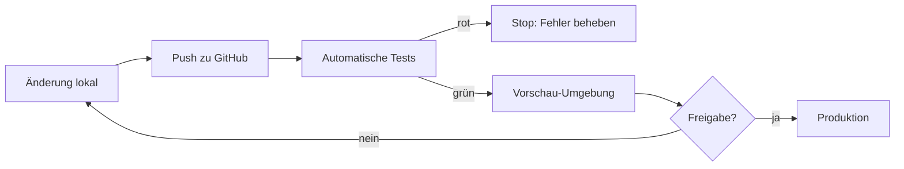

# Phase 20 – Betrieb, Monitoring & Backups

> Kurz: Wie kommt die App sicher auf den Server, wie merkst du Probleme, wie hilfst du Nutzern – und was tust du im Notfall?

| | |
|---|---|
| **Ziel** | Umgebungen und Auslieferung (CI/CD, Rollback, Feature-Flags), Überwachung, Backups mit Wiederherstellungstest, Incident-Plan, Support, Statusseite, Lieferkette, Release-Checkliste |
| **Ergebnis** | `projekte/<slug>/20-betrieb.md` + ausgefüllt `projekte/<slug>/20-incident-plan.md` (Vorlage: `templates/incident-plan.md`), `projekte/<slug>/20-support-playbook.md` (Vorlage: `templates/support-playbook.md`) und `projekte/<slug>/20-release-checkliste.md` (Vorlage: `templates/release-checkliste.md`) |
| **Visual** | Deployment-Ablauf (Mermaid) |
| **Dauer** | ca. 30–45 Minuten (Lite/Einzelperson: Kurzfassung der Vorlagen) |
| **Überspringen** | Lite-Modus: optional, aber **vor Veröffentlichung Pflicht**. Reine lokale App: stark verkürzt |

## Für Einsteiger erklärt

Wenn die App live ist, fängt die Arbeit erst an: Neue Versionen müssen sicher veröffentlicht werden, Fehler müssen auffallen, bevor Nutzer sich beschweren, und Daten dürfen nie verloren gehen. Ein **Backup**, das man nie zurückgespielt hat, ist kein Backup – sondern eine Hoffnung.

Zum Betrieb gehören außerdem Dinge, die man leicht vergisst: eine getrennte **Vorschau-Umgebung** zum Ausprobieren, eine **Pipeline**, die vor jeder Veröffentlichung automatisch prüft, ein **Rückweg** (Rollback) für den Fall, dass ein Update schiefgeht, ein **Notfallplan** für Pannen und Datenlecks, ein geordneter **Support** für Nutzer und die Pflege der **fremden Bausteine**, aus denen deine App besteht (Lieferkette). Die Hintergründe stehen in den Leitfäden `guides/auslieferung.md` und `guides/lieferkette.md`; Fachbegriffe erklärt `guides/glossar.md`.

## Fragen

**Q1 – Wer kümmert sich um die App, wenn etwas kaputtgeht?**
- a) Nur ich
- b) Ich und jemand anderes (wer?)
- c) Ein Dienstleister

**Q2 – Wie schnell musst du reagieren können?**
- a) Innerhalb weniger Stunden
- b) Innerhalb von 1–2 Tagen **(realistisch für Einzelpersonen)**
- c) Wenn ich Zeit habe

**Q3 – Wie viele Daten dürfte man im schlimmsten Fall verlieren?**
- a) Gar keine
- b) Maximal die letzten 24 Stunden **(üblich bei täglichem Backup)**
- c) Ist nicht schlimm

**Q4 – Welche Umgebungen soll es geben?**
- a) Lokal und Produktion (genügt bei Stufe 1 oder rein lokaler App)
- b) Lokal, Vorschau (Staging) und Produktion, mit getrennten Datenbanken und Schlüsseln **(Empfehlung ab Stufe 2)**
- c) Wie b), zusätzlich eine eigene Vorschau pro Änderung (Pull Request)
- d) Weiß ich nicht – schlag du etwas vor
→ Details und Begründung: `guides/auslieferung.md`, Abschnitt „Umgebungen“.

**Q5 – Wer darf neue Versionen in Produktion veröffentlichen?**
- a) Nur ich, nach grüner Pipeline und Prüfung der Vorschau **(Empfehlung bei Einzelpersonen)**
- b) Ich und eine zweite Person; eine Freigabe pro Release
- c) Automatisch, sobald die Pipeline grün ist (ohne menschliche Freigabe)
- d) Weiß ich nicht – schlag du etwas vor

**Q6 – Wie gehst du vor, wenn ein Update Probleme macht?**
- a) Sofort auf die vorherige Version zurückrollen und in Ruhe analysieren **(Empfehlung)**
- b) Erst versuchen, den Fehler im laufenden Betrieb zu beheben
- c) Kommt auf die Art des Fehlers an (dann: Kriterien festlegen)
- d) Weiß ich nicht – schlag du etwas vor
→ Das Rollback-Kriterium und die verantwortliche Person werden im Ergebnis-Dokument und in der Release-Checkliste festgehalten.

**Q7 – Sollen Funktionen mit Schaltern (Feature-Flags oder Kill-Switches) ein- und ausgeschaltet werden können?**
- a) Nein, nicht im MVP
- b) Nur Kill-Switches für teure oder riskante Funktionen (KI, SMS, Zahlungen, Uploads) **(Empfehlung ab Stufe 2 mit kostenverursachenden Funktionen)**
- c) Ja, auch Release-Flags für größere neue Funktionen
- d) Weiß ich nicht – schlag du etwas vor

**Q8 – Wer leitet im Notfall (Datenpanne, Hack, Ausfall) die Reaktion, und wer vertritt?**
- a) Nur ich; Vertretung: … (Name nennen)
- b) Ich und eine technisch versierte Person
- c) Ein Dienstleister bzw. Team (Namen und Erreichbarkeit nennen)
- d) Weiß ich nicht – schlag du etwas vor
→ Stufe 3: Eine Fachperson für Recht/Datenschutz **vorab** benennen.

**Q9 – Wie oft willst du den Notfallplan üben?**
- a) Einmal vor dem Launch und danach im Rhythmus der Wartungsroutine **(Empfehlung)**
- b) Nur einmal vor dem Launch
- c) Gar nicht
- d) Weiß ich nicht – schlag du etwas vor

**Q10 – Über welchen Kanal erreichen dich Nutzer bei Fragen und Problemen?**
- a) Eigene Support-E-Mail-Adresse und eine kurze Hilfe-Seite **(Empfehlung für den Start)**
- b) Kontaktformular in der App
- c) Ticket-System oder Helpdesk-Dienst
- d) Weiß ich nicht – schlag du etwas vor
→ Jeder externe Dienst im Support braucht eine datenschutzrechtliche Prüfung (Phase 16).

**Q11 – Welche Antwortzeit im Support willst du Nutzern zusagen?** (Deine Entscheidung – nur zusagen, was du hältst.)
- a) Innerhalb von 1–2 Werktagen
- b) Innerhalb von einer Woche
- c) Keine Zusage, ich antworte, so schnell ich kann
- d) Weiß ich nicht – schlag du etwas vor

**Q12 – Soll es eine Statusseite oder einen Störungshinweis für Nutzer geben?**
- a) Nein, ich informiere nur per E-Mail oder im Support
- b) Ein einfacher Hinweis in der App oder auf einer eigenen Seite **(Empfehlung für den Start)**
- c) Eine eigene Statusseite, getrennt gehostet, mit Verlauf
- d) Weiß ich nicht – schlag du etwas vor

**Q13 – In welchem Takt sollen Abhängigkeiten (Fremdbibliotheken) aktualisiert und auf Schwachstellen geprüft werden?**
- a) Automatische Prüfung bei jedem Build und regelmäßige Update-Runde im Wartungstakt; Sicherheitsupdates sofort **(Empfehlung)**
- b) Nur vor Releases
- c) Nur, wenn etwas kaputtgeht
- d) Weiß ich nicht – schlag du etwas vor
→ Konkrete Schwellen (ab welchem Schweregrad ein Release stoppt) legst du in Phase 14 fest; Ausgangspunkt `security/standardwerte.md`, Regel 9.2 in `security/regeln-fuer-ki.md`.

**Q14 – Soll für die App eine Software-Stückliste (SBOM) erzeugt werden?**
- a) Nein, das Lockfile genügt (Stufe 1, privat)
- b) Ja, automatisch bei jedem Release **(Empfehlung ab Stufe 3 oder bei Auftraggeber-Anforderung)**
- c) Erst, wenn jemand sie verlangt
- d) Weiß ich nicht – schlag du etwas vor
→ Erklärung: `guides/lieferkette.md`, Abschnitt „SBOM“.

**Q15 – Wie verbindlich soll die Release-Checkliste sein?**
- a) Pflicht bei jedem Release, auch bei kleinen Änderungen (Kurzfassung erlaubt) **(Empfehlung)**
- b) Nur bei Releases mit Datenbank-Änderung, neuen Abhängigkeiten oder Rechte-Änderungen
- c) Nur als Gedächtnisstütze
- d) Weiß ich nicht – schlag du etwas vor

## Was die KI selbst ergänzen soll

- **Deployment-Ablauf**: Code auf GitHub → automatische Tests → Vorschau-Umgebung → Freigabe → Produktion. Kein direktes Ändern in Produktion.
- **Datenbank-Änderungen** nur über Migrationen (versioniert, nachvollziehbar), vorher Backup.
- **Monitoring**:
  - Fehler-Tracking (z. B. Sentry – EU-Region / Datenschutz prüfen, keine sensiblen Daten mitsenden)
  - Uptime-Überwachung mit Benachrichtigung
  - Kosten-Alarme (Phase 17)
  - Sicherheits-Alarme (viele Fehllogins, Rate-Limit-Spitzen; Phase 14 J)
- **Backups**: Häufigkeit passend zu Q3, Aufbewahrung, verschlüsselt, an einem zweiten Ort; **Wiederherstellung einmal vor Launch testen** und danach regelmäßig (z. B. vierteljährlich).
- **Notfallplan** (einseitig, in einfacher Sprache):
  1. App nicht erreichbar → …
  2. Verdacht auf Datenleck / Hack → Zugänge sperren, Schlüssel rotieren, Beweise sichern (Logs), betroffene Daten eingrenzen, **innerhalb von 72 Stunden** Meldepflicht an die Datenschutz-Aufsichtsbehörde prüfen (Frist und Quelle: `guides/recht-eu-ueberblick.md`; die Frist kann ab Kenntnis laufen), ggf. Nutzer informieren
  3. Geheimer Schlüssel versehentlich veröffentlicht → sofort widerrufen und neu erzeugen (Löschen aus Git reicht **nicht**)
  4. Kostenexplosion → Dienst pausieren, Limits prüfen
  5. Kaputtes Update → auf vorherige Version zurückrollen
  - Der ausführliche Plan (Rollen, erste 60 Minuten, Beweissicherung, Schlüssel rotieren, Kommunikation, Meldepflicht, Postmortem, Kontaktliste, Übung) kommt aus `templates/incident-plan.md`; die einseitige Fassung hier verweist darauf.
- **Zugänge absichern**: 2FA für GitHub, Hosting, Datenbank, Domain-Anbieter, E-Mail-Konto, App-Store-Konten. Notfall-Wiederherstellungscodes sicher aufbewahren.
- **Wartungsroutine**: monatlich Abhängigkeiten aktualisieren, Logs/Alarme sichten; Lieferketten-Update und Incident-Übung gemäß Phase 24.

**Zusätzlich in Phase 20 (neu in Version 1.2):**

- **Umgebungen, CI/CD, Rollback, Feature-Flags:** Lege nach `guides/auslieferung.md` fest: Umgebungen mit getrennten Datenbanken und Schlüsseln (Phase 13 gibt den Rahmen vor), Pipeline-Stufen (Installation aus Lockfile, Typprüfung, Tests inkl. Sicherheitstests, Abhängigkeitsprüfung, Secret-Scan, Build, Vorschau, Freigabe, Produktion, Smoke-Test), Geheimnisse pro Umgebung als Übersichtstabelle (ohne Werte), Datenbank-Migrationen nur über Migrationsdateien mit Backup vorher und **rückwärtskompatibel in zwei Schritten (expand / contract)**, nie manuell in Produktion. Rollback-Weg und **Rollback-Kriterium** vorab festlegen; Rollback einmal in der Vorschau üben.
- **Feature-Flags / Kill-Switches:** nur festlegen, was du wirklich brauchst; Standardwert für neue Funktionen sicher; Flags ersetzen nie die Zugriffskontrolle (Regel 2.9), werden serverseitig entschieden und bekommen Besitzer und Ablaufdatum.
- **Release-Checkliste:** Kopiere `templates/release-checkliste.md` für jedes Release; sie umfasst Backup, Migration, Smoke-Test und Rollback-Kriterium. Lege fest, wie verbindlich sie ist (Q15).
- **Incident-Plan:** Fülle `templates/incident-plan.md` aus (Rollen, Schweregrade, erste 60 Minuten, Beweissicherung, Schlüssel rotieren, Kommunikation, Meldepflicht-Entscheidung, Postmortem, Kontaktliste, Übungstermin). **Fristen der Meldepflicht stehen nicht im Plan, sondern in `guides/recht-eu-ueberblick.md`** – verweise darauf und trage dort geprüfte Fristen ein, rate nie.
- **Support:** Fülle `templates/support-playbook.md` aus (Kanal, Antwortzeiten als deine Entscheidung, Standardantworten für Konto gelöscht, Datenauskunft, Fehlermeldung, Zahlungsproblem und Missbrauchsmeldung, Identitätsprüfung, Eskalation). Grundsatz: **nie nach Passwörtern oder Codes fragen**.
- **Statusseite und Störungskommunikation:** je nach Q12 einfache Lösung festlegen; Textbausteine stehen im Support-Playbook; bei möglichem Datenbezug zuerst Einsatzleitung und Datenschutz einbinden.
- **Lieferkette:** Nach `guides/lieferkette.md`: Lockfile-Pflicht, Auswahlkriterien für neue Pakete, Schutz vor Typosquatting und **von KI erfundenen Paketnamen** (jeden neuen Namen gegen die offizielle Dokumentation prüfen), Update-Routine, Schwachstellen-Scans, Lizenzprüfung, SBOM (Q14), Absicherung der Pipeline (fest gebundene Actions, minimale Token-Rechte, Secrets einzeln und sparsam).
- **Zeitangaben im Betrieb:** Logs, Alarme, Backups, Vorfall-Protokoll und geplante Jobs in UTC (Begründung: Phase 18).

## Missbrauchs- und Sicherheitscheck

- Wer hat **Zugriff auf die Produktionsdatenbank**? So wenige wie möglich, jeweils mit 2FA.
- Logs enthalten keine Passwörter, Tokens oder sensiblen Inhalte (Phase 14 J).
- Backups unterliegen denselben Löschpflichten (nach Ablauf der Backup-Frist sind gelöschte Daten auch dort weg).
- **Pipeline = Hauptziel:** Sie besitzt Schlüssel zum Hosting. Aktionen fest binden, minimale Rechte, Secrets einzeln und nur für Produktion mit Freigabe (`guides/lieferkette.md`, Abschnitt „GitHub Actions und CI absichern"). Eine Änderung an Workflow-Dateien ist eine sicherheitsrelevante Änderung.
- **Keine echten Nutzerdaten** in lokalen und Vorschau-Umgebungen; Vorschau nicht öffentlich und nicht für Suchmaschinen (`guides/auslieferung.md`).
- **Migrationen nie manuell in Produktion**, immer mit Backup; neue Tabellen nur mit aktivierter Zugriffskontrolle (Regel 2.2).
- **Feature-Flags** dürfen keine Berechtigungen ersetzen (Regel 2.9) und nicht vom Client steuerbar sein.
- **Social Engineering im Support:** Betrüger geben sich als Nutzer aus, um Konten zu übernehmen oder Daten zu erschleichen. Darum Identität prüfen, nie Passwörter oder Codes erfragen, keine Daten an unbestätigte Adressen (`templates/support-playbook.md`).
- **Neue Pakete:** Namen gegen offizielle Dokumentation prüfen; KI kann Paketnamen erfinden, und Angreifer registrieren solche Namen (`guides/lieferkette.md`).
- **Vorfall-Beweise und Nutzerdaten** nicht in Chats, Tickets oder KI-Werkzeuge kopieren; nur Kennungen verwenden.
- **Alarme und Logs** enthalten weder Geheimnisse noch sensible Inhalte (Regel 7.2); Aufbewahrung nach `security/standardwerte.md`, Abschnitt 9.
- **Wiederherstellung und Rollback** wurden wirklich getestet, nicht nur geplant (Regel 10.5: nichts als erledigt behaupten ohne Nachweis).

## Ergebnis-Dokument `20-betrieb.md`

````markdown
# Betrieb

## Deployment


## Monitoring & Alarme
| Was | Werkzeug | Alarm an |
|---|---|---|

## Umgebungen
| Umgebung | Zweck | Datenbank | Schlüssel | Zugriff | Adresse |
|---|---|---|---|---|---|
| Lokal | | Testdaten | | | |
| Vorschau | | getrennte Testdatenbank | | geschützt | |
| Produktion | | | | wenige Personen mit 2FA | |

## Pipeline (CI/CD)
| Stufe | Werkzeug | Bei Fehler | Nachweis |
|---|---|---|---|
| Installation aus Lockfile | | Stopp | |
| Typprüfung | | Stopp | |
| Tests inkl. Sicherheitstests | | Stopp | |
| Abhängigkeitsprüfung | | Stopp ab Schwelle (Phase 14) | |
| Secret-Scan | | Stopp + Schlüssel widerrufen | |
| Build | | Stopp | |
| Vorschau-Deployment | | Stopp | |
| Freigabe | | – | |
| Produktion + Smoke-Test | | Rollback | |

Wer darf in Produktion veröffentlichen: … · Schutz von `main`: …

## Geheimnisse pro Umgebung (ohne Werte)
| Geheimnis | Zweck | Lokal | Vorschau | Produktion | Wo gespeichert | Wer hat Zugriff | Zuletzt erneuert |
|---|---|---|---|---|---|---|---|

## Datenbank-Migrationen
- Vorgehen: nur über Migrationsdateien, nie manuell in Produktion; Backup vorher; expand (rückwärtskompatibel) – später contract als eigener Release
- Aufräum-Aufgaben: TASK-…

## Rollback
| Art der Änderung | Rollback-Weg | Bedingung |
|---|---|---|
- Rollback-Kriterium: …
- Entscheidet: …
- Rollback geübt am: …

## Feature-Flags / Kill-Switches
| Flag | Zweck | Standardwert | Besitzer | Ablaufdatum / Entfernen bis |
|---|---|---|---|---|

## Release-Ablauf
Verweis auf ausgefüllte `20-release-checkliste.md`; Verbindlichkeit: …

## Backups
- Häufigkeit / Aufbewahrung / Ort: … (Ausgangswerte: `security/standardwerte.md`, Abschnitt 10)
- Wiederherstellung getestet am: …

## Notfallplan
Kurzfassung (eine Seite, einfache Sprache) – ausführlich in `20-incident-plan.md`:
- Einsatzleitung / Vertretung: …
- Die 5 häufigsten Fälle: App nicht erreichbar · Datenleck/Hack · Schlüssel veröffentlicht · Kostenexplosion · kaputtes Update
- Meldepflicht-Entscheidung: siehe `guides/recht-eu-ueberblick.md` (Fristen dort nachsehen)
- Nächste Übung: …

## Support
Verweis auf `20-support-playbook.md`: Kanal …, Antwortzeit-Zusage …, Standardantworten ☐ vorhanden, Identitätsprüfung ☐ festgelegt, Eskalation ☐ festgelegt.

## Statusseite / Störungskommunikation
- Lösung: … · Adresse: … · Verantwortliche/r: … · Textbausteine: im Support-Playbook

## Lieferkette
| Punkt | Festlegung |
|---|---|
| Lockfile + Installation in CI | |
| Auswahlkriterien für neue Pakete / Freigabe durch | |
| Schutz vor erfundenen Paketnamen | Prüfung gegen offizielle Dokumentation |
| Schwachstellen-Scan und Schwelle | Phase 14 / Regel 9.2 |
| Automatische Update-Vorschläge | |
| Update-Takt | |
| Lizenzliste (Ablageort) | |
| SBOM | ☐ nein ☐ ja: Format …, Ablage … |
| Absicherung der Pipeline (Actions, Token, Secrets) | |

## Zugänge (mit 2FA)
| Dienst | 2FA aktiv | Wiederherstellungscodes sicher |
|---|---|---|

## Wartungsroutine
…(inklusive Lieferketten-Update und Incident-Übung, siehe Phase 24)

## Quellen
(Verweise auf `QUELLEN.md`; Belege der Leitfäden stehen in `guides/auslieferung.md` und `guides/lieferkette.md`)
````

## Definition of Done
- [ ] Deployment-Ablauf festgelegt
- [ ] Monitoring und Alarme geplant
- [ ] Backup-Konzept mit Wiederherstellungstest
- [ ] Notfallplan auf einer Seite
- [ ] 2FA-Liste für alle Zugänge
- [ ] Umgebungen mit getrennten Datenbanken und Schlüsseln festgelegt; Geheimnis-Übersicht ohne Werte
- [ ] Pipeline-Stufen (inkl. Abhängigkeitsprüfung und Secret-Scan) und Freigabeverfahren festgelegt
- [ ] Migrationsvorgehen (Backup, expand/contract, nie manuell in Produktion) festgelegt
- [ ] Rollback-Weg und Rollback-Kriterium festgelegt; Rollback einmal geübt
- [ ] Feature-Flags/Kill-Switches entschieden (oder bewusst keine)
- [ ] Release-Checkliste angelegt (`20-release-checkliste.md`)
- [ ] Incident-Plan ausgefüllt (`20-incident-plan.md`) mit Rollen, Kontaktliste und Übungstermin; Meldepflicht-Entscheidung verweist auf den Rechts-Überblick
- [ ] Support-Playbook ausgefüllt (`20-support-playbook.md`) mit Kanal, Zusage zur Antwortzeit, Identitätsprüfung und Eskalation
- [ ] Statusseite bzw. Störungskommunikation entschieden
- [ ] Lieferketten-Regeln festgelegt (Lockfile, Paketauswahl, Scans, Updates, Lizenzen, SBOM-Entscheidung, Pipeline-Absicherung)

→ **Standard-Gate**
