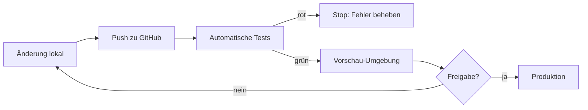

# Phase 20 – Betrieb, Monitoring & Backups

> Kurz: Wie kommt die App auf den Server, wie merkst du Probleme – und was tust du im Notfall?

| | |
|---|---|
| **Ziel** | Deployment-Ablauf, Überwachung, Backups mit Wiederherstellungstest, Notfallplan |
| **Ergebnis** | `projekte/<slug>/20-betrieb.md` |
| **Visual** | Deployment-Ablauf (Mermaid) |
| **Dauer** | ca. 15 Minuten |
| **Überspringen** | Lite-Modus: optional, aber **vor Veröffentlichung Pflicht**. Reine lokale App: stark verkürzt |

## Für Einsteiger erklärt

Wenn die App live ist, fängt die Arbeit erst an: Neue Versionen müssen sicher veröffentlicht werden, Fehler müssen auffallen, bevor Nutzer sich beschweren, und Daten dürfen nie verloren gehen. Ein **Backup**, das man nie zurückgespielt hat, ist kein Backup – sondern eine Hoffnung.

## Fragen

**Q1 – Wer kümmert sich um die App, wenn etwas kaputtgeht?**
- a) Nur ich
- b) Ich und jemand anderes (wer?)
- c) Ein Dienstleister

**Q2 – Wie schnell musst du reagieren können?**
- a) Innerhalb weniger Stunden
- b) Innerhalb von 1–2 Tagen **(realistisch für Einzelpersonen)**
- c) Wenn ich Zeit habe

**Q3 – Wie viele Daten dürfte man im schlimmsten Fall verlieren?**
- a) Gar keine
- b) Maximal die letzten 24 Stunden **(üblich bei täglichem Backup)**
- c) Ist nicht schlimm

## Was die KI selbst ergänzen soll

- **Deployment-Ablauf**: Code auf GitHub → automatische Tests → Vorschau-Umgebung → Freigabe → Produktion. Kein direktes Ändern in Produktion.
- **Datenbank-Änderungen** nur über Migrationen (versioniert, nachvollziehbar), vorher Backup.
- **Monitoring**:
  - Fehler-Tracking (z. B. Sentry – EU-Region / Datenschutz prüfen, keine sensiblen Daten mitsenden)
  - Uptime-Überwachung mit Benachrichtigung
  - Kosten-Alarme (Phase 17)
  - Sicherheits-Alarme (viele Fehllogins, Rate-Limit-Spitzen; Phase 14 J)
- **Backups**: Häufigkeit passend zu Q3, Aufbewahrung, verschlüsselt, an einem zweiten Ort; **Wiederherstellung einmal vor Launch testen** und danach regelmäßig (z. B. vierteljährlich).
- **Notfallplan** (einseitig, in einfacher Sprache):
  1. App nicht erreichbar → …
  2. Verdacht auf Datenleck / Hack → Zugänge sperren, Schlüssel rotieren, Beweise sichern (Logs), betroffene Daten eingrenzen, **innerhalb von 72 Stunden** Meldepflicht an die Datenschutz-Aufsichtsbehörde prüfen, ggf. Nutzer informieren
  3. Geheimer Schlüssel versehentlich veröffentlicht → sofort widerrufen und neu erzeugen (Löschen aus Git reicht **nicht**)
  4. Kostenexplosion → Dienst pausieren, Limits prüfen
  5. Kaputtes Update → auf vorherige Version zurückrollen
- **Zugänge absichern**: 2FA für GitHub, Hosting, Datenbank, Domain-Anbieter, E-Mail-Konto, App-Store-Konten. Notfall-Wiederherstellungscodes sicher aufbewahren.
- **Wartungsroutine**: monatlich Abhängigkeiten aktualisieren, Logs/Alarme sichten.

## Missbrauchs- und Sicherheitscheck

- Wer hat **Zugriff auf die Produktionsdatenbank**? So wenige wie möglich, jeweils mit 2FA.
- Logs enthalten keine Passwörter, Tokens oder sensiblen Inhalte (Phase 14 J).
- Backups unterliegen denselben Löschpflichten (nach Ablauf der Backup-Frist sind gelöschte Daten auch dort weg).

## Ergebnis-Dokument `20-betrieb.md`

````markdown
# Betrieb

## Deployment


## Monitoring & Alarme
| Was | Werkzeug | Alarm an |
|---|---|---|

## Backups
- Häufigkeit / Aufbewahrung / Ort: …
- Wiederherstellung getestet am: …

## Notfallplan
…

## Zugänge (mit 2FA)
| Dienst | 2FA aktiv | Wiederherstellungscodes sicher |
|---|---|---|

## Wartungsroutine
…
````

## Definition of Done
- [ ] Deployment-Ablauf festgelegt
- [ ] Monitoring und Alarme geplant
- [ ] Backup-Konzept mit Wiederherstellungstest
- [ ] Notfallplan auf einer Seite
- [ ] 2FA-Liste für alle Zugänge

→ **Standard-Gate**
