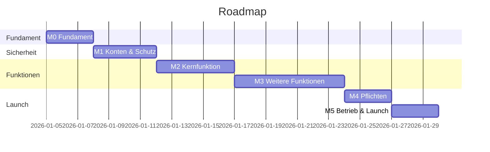

# Phase 21 – Roadmap & Aufgaben

> Kurz: In welcher Reihenfolge wird gebaut – in kleinen, prüfbaren Schritten?

| | |
|---|---|
| **Ziel** | Meilensteine und eine geordnete Aufgabenliste, die ein Coding-Tool abarbeiten kann |
| **Ergebnis** | `projekte/<slug>/21-roadmap.md` |
| **Visual** | Roadmap (Mermaid-Gantt oder Zeitleiste) |
| **Dauer** | ca. 15 Minuten |
| **Überspringen** | nie |

## Für Einsteiger erklärt

Eine App baut man nicht in einem Rutsch. KI-Tools arbeiten am besten mit **kleinen, klar umrissenen Aufgaben**: „Baue den Login“ ist zu groß, „Baue das Registrierungsformular mit Validierung und Test“ ist gut. Jede Aufgabe endet mit etwas, das man ausprobieren kann. So merkst du früh, wenn etwas in die falsche Richtung läuft.

## Fragen

**Q1 – Was willst du als Erstes in der Hand halten?** (Der erste Meilenstein sollte die **Kernfunktion** zeigen, auch wenn noch vieles fehlt.)

**Q2 – Die KI zeigt Meilensteine und Aufgaben. Passt die Reihenfolge?**

**Q3 – Soll die Aufgabenliste zusätzlich als GitHub-Issues angelegt werden?** (Nur wenn das Tool Zugriff hat.)
- a) Ja
- b) Nein, die Markdown-Liste reicht **(Standard)**

## Was die KI selbst ergänzen soll

Typische Meilenstein-Reihenfolge (anpassen):

1. **M0 – Fundament**: Projekt anlegen, Git, Umgebungen, `.env.example`, Security-Header, CI mit Tests, Design-Tokens, Grundlayout
2. **M1 – Sicherheit & Konten** (falls Konten): Login über Anbieter, Datenbankregeln (RLS), Besitzprüfung, Rate Limits, **Pflicht-Sicherheitstests** – *vor* den Fachfunktionen, damit alles darauf aufbaut
3. **M2 – Kernfunktion**: die eine Sache aus Phase 5 Q2, Ende-zu-Ende nutzbar
4. **M3 – weitere Muss-Funktionen**
5. **M4 – Pflichten vor Launch**: Datenexport, Konto löschen, Impressum/Datenschutz, Einwilligungen, Barrierefreiheit-Check
6. **M5 – Betrieb & Launch-Vorbereitung**: Monitoring, Backups + Wiederherstellungstest, Sicherheits-Checkliste, Beta-Test

Jede Aufgabe enthält:
- ID, Titel, Meilenstein
- Ziel in einem Satz
- Bezug (Funktion F…, Screen S…, Flow, Sicherheitsabschnitt)
- Akzeptanzkriterien (aus Phase 19)
- Sicherheitsregeln, die hier besonders gelten
- Abhängigkeiten
- Größe: S (< 1 Std. KI-Arbeit), M, L – **L-Aufgaben weiter aufteilen**

Ehrlich prüfen: Passt der Umfang zum Zeitbudget aus Phase 5? Wenn nicht: sagen, was verschoben werden sollte.

## Missbrauchs- und Sicherheitscheck

- Sicherheitsgrundlagen (M0/M1) stehen **vor** den Fachfunktionen – nachträgliches Absichern ist teurer und fehleranfälliger.
- Jede Aufgabe, die Daten lesen/schreiben lässt, hat einen zugehörigen Berechtigungstest.

## Ergebnis-Dokument `21-roadmap.md`

````markdown
# Roadmap



## Aufgaben
| ID | Meilenstein | Titel | Bezug | Akzeptanzkriterien | Sicherheit | Abhängig von | Größe | Status |
|---|---|---|---|---|---|---|---|---|
| T-001 | M0 | Projekt mit Vite + TS anlegen | – | Startseite lädt, Lint & Tests laufen in CI | .env in .gitignore | – | S | offen |
````

## Definition of Done
- [ ] Meilensteine mit Kernfunktion früh
- [ ] Sicherheitsgrundlagen vor Fachfunktionen
- [ ] Jede Aufgabe ≤ M, mit Akzeptanzkriterien
- [ ] Umfang zum Zeitbudget geprüft

→ **Standard-Gate**
