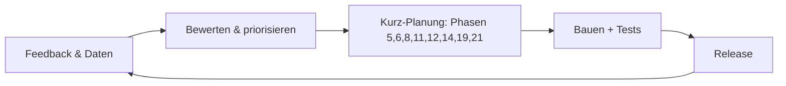

# Phase 24 – Iteration & Wartung

> Kurz: Wie entwickelst du die App nach dem Start weiter, ohne dass sie verwahrlost?

| | |
|---|---|
| **Ziel** | Support- und Feedback-Schleife, Wartungsroutine (inkl. Lieferketten-Update und Incident-Übung), Änderungs-Log, Weg zurück in den Planungsprozess |
| **Ergebnis** | `projekte/<slug>/24-iteration.md` + `CHANGELOG.md` im App-Repository |
| **Visual** | Kreislauf-Diagramm (Mermaid) |
| **Dauer** | ca. 15 Minuten |
| **Überspringen** | Lite-Modus |

## Für Einsteiger erklärt

Eine App ist nie „fertig“. Nutzer finden Fehler und wünschen sich Funktionen, Bibliotheken bekommen Sicherheitsupdates, Anbieter ändern Preise. Wer nichts tut, hat nach einem Jahr eine unsichere App. Mit einer kleinen, festen Routine bleibt das überschaubar.

Zwei Dinge gehören dazu, die man gern vergisst: Die **Rückmeldungen deiner Nutzer** (Support, Bewertungen, Fehlermeldungen) sind deine beste Quelle für Verbesserungen – wenn du sie systematisch einsammelst. Und die **fremden Bausteine** deiner App (Bibliotheken, Hosting, Pipeline) altern: Sie brauchen regelmäßige Pflege (`guides/lieferkette.md`). Außerdem sollte der Notfallplan aus Phase 20 nicht in der Schublade verstauben, sondern ab und zu geübt werden (`templates/incident-plan.md`).

## Fragen

**Q1 – Wie viel Zeit kannst du nach dem Launch regelmäßig investieren?** (z. B. 1 Stunde pro Woche)

**Q2 – Wie entscheidest du, was als Nächstes gebaut wird?**
- a) Was die meisten Nutzer wünschen
- b) Was das Kernproblem am meisten verbessert **(Empfehlung)**
- c) Was ich selbst brauche

**Q3 – Woran erkennst du, ob die App ihr Ziel erreicht?** (Erfolgskriterium aus Phase 1 – wie misst du es datenschutzfreundlich?)

**Q4 – Wie sammelst du Rückmeldungen von Nutzern ein?**
- a) Über den Support-Kanal aus Phase 20 (E-Mail, Formular) und die Hilfe-Seite **(Empfehlung für den Start)**
- b) Zusätzlich über eine kurze Rückfrage in der App (z. B. nach einer Funktion)
- c) Zusätzlich über Bewertungen in den App-Stores und soziale Medien
- d) Weiß ich nicht – schlag du etwas vor
→ Jeder zusätzliche Kanal braucht eine datenschutzrechtliche Prüfung (Phase 16).

**Q5 – Wie oft wertest du Support-Anfragen und Rückmeldungen aus?**
- a) Wöchentlich kurz sichten, monatlich nach Kategorien auswerten **(Empfehlung)**
- b) Nur monatlich
- c) Nur bei Bedarf
- d) Weiß ich nicht – schlag du etwas vor

**Q6 – In welchem Takt aktualisierst du Abhängigkeiten und prüfst die Lieferkette?**
- a) Sicherheitsupdates sofort, übrige Updates monatlich, große Versionssprünge als geplante Aufgabe **(Empfehlung)**
- b) Quartalsweise
- c) Nur, wenn ein Warnhinweis kommt
- d) Weiß ich nicht – schlag du etwas vor
→ Ablauf und Prüfpunkte: `guides/lieferkette.md`.

**Q7 – Wie oft übst du den Notfallplan?**
- a) Einmal im Jahr eine Tischübung mit einem Szenario, zusätzlich nach größeren Änderungen **(Empfehlung)**
- b) Halbjährlich
- c) Nur einmal vor dem Launch
- d) Weiß ich nicht – schlag du etwas vor
→ Szenarien und Vorlage: `templates/incident-plan.md`, Abschnitt „Übung“. Den Rhythmus hast du ggf. schon in Phase 20 festgelegt – dann hier bestätigen.

## Was die KI selbst ergänzen soll

- **Kreislauf**: Feedback (Support, Fehlermeldungen, Auswertung) sammeln → bewerten → neue Funktion durchläuft **verkürzt die relevanten Phasen** (mindestens 5, 6, 8, 11, 12, 14, 19, 21) → bauen → testen → veröffentlichen.
- **Sobald es Code gibt**, laufen größere Änderungen am besten über den Modus **„Bestehende App“** (Ziel „Weiterentwickeln“): Dann wird der echte Code als Ist-Zustand eingelesen, und Abweichungen aus `docs/aenderungen.md` fließen in den Plan zurück.
- **Wartungsroutine**:
  - wöchentlich: Feedback, Support-Eingänge und Fehlermeldungen sichten, Alarme prüfen
  - monatlich: Abhängigkeiten aktualisieren (Sicherheitsupdates sofort), **Lieferketten-Update** (Schwachstellen-Scan, automatische Update-Vorschläge abarbeiten, nicht mehr genutzte Pakete entfernen, ungepflegte Pakete bewerten – `guides/lieferkette.md`), Kosten prüfen, Support-Eingänge nach Kategorien auswerten
  - vierteljährlich: Backup-Wiederherstellung testen, Zugänge und Berechtigungen prüfen (wer hat noch Admin-Rechte?), Datenschutzerklärung mit Technik abgleichen, Geheimnis-Übersicht und Rotationsplan prüfen, Pipeline- und Workflow-Einstellungen prüfen (`guides/lieferkette.md`), Lizenzliste und – falls erzeugt – SBOM aktualisieren, Feature-Flags aufräumen (abgelaufene entfernen, `guides/auslieferung.md`), Support-Playbook und Standardantworten auf Aktualität prüfen (`templates/support-playbook.md`)
  - jährlich bzw. im festgelegten Rhythmus: **Incident-Übung** (Tischübung mit einem Szenario laut `templates/incident-plan.md`, Lücken in Plan und Kontaktliste beheben), Sicherheits-Checkliste komplett, ggf. externe Prüfung (Stufe 3), Rechts-Überblick auf Änderungen prüfen (`guides/recht-eu-ueberblick.md`)
  - nach jedem Release: Release-Checkliste abschließen, Aufräumaufgaben (contract-Migration, Flag entfernen) einplanen (`templates/release-checkliste.md`)
  - nach jedem Vorfall: schuldfreies Postmortem und Maßnahmen als `TASK-…` eintragen
- **Support- und Feedback-Schleife**: Der Support (Phase 20, `templates/support-playbook.md`) erfasst jede Anfrage mit einer Kategorie (Fehler, Bedienung unklar, Funktionswunsch, Zahlung, Datenschutz, Missbrauch, Sicherheit). Regelmäßig auswerten: Welche Kategorien häufen sich? Häufige Fragen wandern in die Hilfe-Seite, wiederkehrende Fehler werden zu Aufgaben mit Test (`TASK-…`, `TEST-…`), Bedienprobleme fließen zurück in User-Flows und Mockups (Phasen 6 bis 8), Sicherheits- und Datenschutzthemen ins Bedrohungsmodell bzw. die Datenschutzdokumentation. Auswertung nur aggregiert und ohne Namen. Bewertungen in App-Stores lesen und freundlich auf den Support-Kanal verweisen.
- **Priorisierung von Rückmeldungen**: Sicherheit und Datenverlust vor Fehlern, Fehler vor Wünschen; Meldungen über fremde Daten, Konto-Übernahmen oder Datenlecks sind **Vorfälle** und laufen nach `templates/incident-plan.md`, nicht durch die normale Warteschlange.
- **Lieferketten-Wartung**: Die Update-Routine aus `guides/lieferkette.md` ist Teil der Wartungsroutine (nicht optional): Lockfile-Änderungen lesen, neue Paketnamen prüfen (KI-Tools können Namen erfinden), Schwachstellen mit Schweregrad hoch/kritisch vor einem Release beheben oder begründet als Risiko (`E-…`) akzeptieren (Regel 9.2 in `security/regeln-fuer-ki.md`).
- **Incident-Übung**: Mindestens im festgelegten Rhythmus (Q7); danach den Plan verbessern und den nächsten Termin eintragen. Auch Backup-Wiederherstellung und Rollback gehören dazu (Werte zum Wiederherstellungstest: `security/standardwerte.md`, Abschnitt 10).
- **Änderungs-Log** (`CHANGELOG.md`) mit Datum, Version, Änderungen – für dich und für Nutzer.
- **Erfolgsmessung** datenschutzfreundlich (aggregierte Zahlen, keine personenbezogene Verfolgung ohne Einwilligung).
- **Wann aufhören?** Ehrlich: Wenn das Erfolgskriterium nach einer festgelegten Zeit klar verfehlt wird, ist Aufhören oder Umbauen eine legitime Entscheidung. Für das Abschalten: Nutzer rechtzeitig informieren, Datenexport ermöglichen, Daten löschen.

## Missbrauchs- und Sicherheitscheck

- **Jede neue Funktion** bekommt den Sicherheitscheck aus Phase 14 und Berechtigungstests – auch kleine.
- Verwaiste Zugänge (ehemalige Helfer, alte API-Schlüssel) regelmäßig entfernen.
- **Support ist ein Angriffsweg:** Prüfe in der Auswertung auffällige Muster (viele Anfragen nach Kontozugang, E-Mail-Änderungen oder Auskünften von unbestätigten Adressen). Identitätsprüfung und das Verbot, nach Passwörtern oder Codes zu fragen, gelten dauerhaft (`templates/support-playbook.md`).
- **Rückmeldungen enthalten oft personenbezogene Daten** (Screenshots, Namen). Nur das Nötigste speichern, nach Bearbeitung löschen, Löschfristen einhalten (`templates/loeschkonzept.md`) und nichts in öffentliche Issue-Tracker oder KI-Werkzeuge kopieren.
- **Neue Pakete und Updates** sind ein Einfallstor: Name prüfen, Lockfile-Änderung lesen, Tests laufen lassen (`guides/lieferkette.md`).
- **Übungen mit Testdaten:** Incident-Übungen und Lasttests nie mit echten Nutzerdaten oder gegen die Produktion.
- **Alte Feature-Flags** können unsichere Wege wieder öffnen – regelmäßig aufräumen (`guides/auslieferung.md`).

## Ergebnis-Dokument `24-iteration.md`

````markdown
# Iteration & Wartung



## Zeitbudget
…

## Priorisierungsregel
…

## Support- und Feedback-Schleife
| Kanal | Auswertungstakt | Kategorien | Wer wertet aus | Wohin fließt es (Aufgaben, FAQ, Phasen) |
|---|---|---|---|---|

## Wartungsroutine
| Rhythmus | Aufgabe | Verantwortlich | Nachweis (Datum letzter Lauf) |
|---|---|---|---|
| wöchentlich | Feedback, Support-Eingänge, Fehlermeldungen, Alarme sichten | | |
| monatlich | Abhängigkeiten aktualisieren, Lieferketten-Update, Kosten prüfen, Support auswerten | | |
| vierteljährlich | Backup-Wiederherstellung testen, Zugänge/Berechtigungen, Geheimnisse und Pipeline-Einstellungen prüfen, Feature-Flags aufräumen, Support-Playbook prüfen | | |
| jährlich / im Rhythmus | Incident-Übung, Sicherheits-Checkliste, ggf. externe Prüfung, Rechts-Überblick prüfen | | |
| nach jedem Release | Release-Checkliste abschließen, Aufräumaufgaben einplanen | | |
| nach jedem Vorfall | Postmortem, Maßnahmen als TASK-… | | |

## Incident-Übungen
| Datum | Szenario | Ergebnis / Lücken | Maßnahmen (TASK-…) | Nächster Termin |
|---|---|---|---|---|

## Erfolgsmessung
…

## Abbruch- / Umbaukriterium
…
````

## Definition of Done
- [ ] Wartungsroutine festgelegt
- [ ] Prozess für neue Funktionen definiert
- [ ] Erfolgsmessung geklärt
- [ ] Support-/Feedback-Schleife festgelegt (Kanäle, Kategorien, Auswertungstakt, Weg zurück in die Planung)
- [ ] Wartungsroutine enthält Lieferketten-Update und Incident-Übung mit Rhythmus und Verantwortlichen
- [ ] Verweise geprüft: `guides/lieferkette.md`, `templates/incident-plan.md`, `templates/support-playbook.md`, `templates/release-checkliste.md`

→ **Abschluss-Gate:** Statt „Weiter zu Phase 25“ zeigt die KI:

```
──────────────────────────────
🎉 Alle Phasen abgeschlossen!
📁 Dein Projekt: projekte/<slug>/
📦 Übergabepaket: projekte/<slug>/handoff/

Wie möchtest du weitermachen?
1️⃣ Zusammenfassung des ganzen Projekts anzeigen
2️⃣ Etwas in einer Phase ändern
3️⃣ Eine neue Funktion planen (verkürzter Durchlauf)
4️⃣ Pause
──────────────────────────────
```
