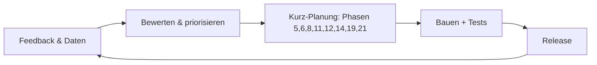

# Phase 24 – Iteration & Wartung

> Kurz: Wie entwickelst du die App nach dem Start weiter, ohne dass sie verwahrlost?

| | |
|---|---|
| **Ziel** | Feedback-Prozess, Wartungsroutine, Änderungs-Log, Weg zurück in den Planungsprozess |
| **Ergebnis** | `projekte/<slug>/24-iteration.md` + `CHANGELOG.md` im App-Repository |
| **Visual** | Kreislauf-Diagramm (Mermaid) |
| **Dauer** | ca. 10 Minuten |
| **Überspringen** | Lite-Modus |

## Für Einsteiger erklärt

Eine App ist nie „fertig“. Nutzer finden Fehler und wünschen sich Funktionen, Bibliotheken bekommen Sicherheitsupdates, Anbieter ändern Preise. Wer nichts tut, hat nach einem Jahr eine unsichere App. Mit einer kleinen, festen Routine bleibt das überschaubar.

## Fragen

**Q1 – Wie viel Zeit kannst du nach dem Launch regelmäßig investieren?** (z. B. 1 Stunde pro Woche)

**Q2 – Wie entscheidest du, was als Nächstes gebaut wird?**
- a) Was die meisten Nutzer wünschen
- b) Was das Kernproblem am meisten verbessert **(Empfehlung)**
- c) Was ich selbst brauche

**Q3 – Woran erkennst du, ob die App ihr Ziel erreicht?** (Erfolgskriterium aus Phase 1 – wie misst du es datenschutzfreundlich?)

## Was die KI selbst ergänzen soll

- **Kreislauf**: Feedback sammeln → bewerten → neue Funktion durchläuft **verkürzt die relevanten Phasen** (mindestens 5, 6, 8, 11, 12, 14, 19, 21) → bauen → testen → veröffentlichen.
- **Wartungsroutine**:
  - wöchentlich: Feedback und Fehlermeldungen sichten, Alarme prüfen
  - monatlich: Abhängigkeiten aktualisieren (Sicherheitsupdates sofort), Kosten prüfen
  - vierteljährlich: Backup-Wiederherstellung testen, Zugänge und Berechtigungen prüfen (wer hat noch Admin-Rechte?), Datenschutzerklärung mit Technik abgleichen
  - jährlich: Sicherheits-Checkliste komplett, ggf. externe Prüfung (Stufe 3)
- **Änderungs-Log** (`CHANGELOG.md`) mit Datum, Version, Änderungen – für dich und für Nutzer.
- **Erfolgsmessung** datenschutzfreundlich (aggregierte Zahlen, keine personenbezogene Verfolgung ohne Einwilligung).
- **Wann aufhören?** Ehrlich: Wenn das Erfolgskriterium nach einer festgelegten Zeit klar verfehlt wird, ist Aufhören oder Umbauen eine legitime Entscheidung. Für das Abschalten: Nutzer rechtzeitig informieren, Datenexport ermöglichen, Daten löschen.

## Missbrauchs- und Sicherheitscheck

- **Jede neue Funktion** bekommt den Sicherheitscheck aus Phase 14 und Berechtigungstests – auch kleine.
- Verwaiste Zugänge (ehemalige Helfer, alte API-Schlüssel) regelmäßig entfernen.

## Ergebnis-Dokument `24-iteration.md`

````markdown
# Iteration & Wartung



## Zeitbudget
…

## Priorisierungsregel
…

## Wartungsroutine
| Rhythmus | Aufgabe |
|---|---|

## Erfolgsmessung
…

## Abbruch- / Umbaukriterium
…
````

## Definition of Done
- [ ] Wartungsroutine festgelegt
- [ ] Prozess für neue Funktionen definiert
- [ ] Erfolgsmessung geklärt

→ **Abschluss-Gate:** Statt „Weiter zu Phase 25“ zeigt die KI:

```
──────────────────────────────
🎉 Alle Phasen abgeschlossen!
📁 Dein Projekt: projekte/<slug>/
📦 Übergabepaket: projekte/<slug>/handoff/

Wie möchtest du weitermachen?
1️⃣ Zusammenfassung des ganzen Projekts anzeigen
2️⃣ Etwas in einer Phase ändern
3️⃣ Eine neue Funktion planen (verkürzter Durchlauf)
4️⃣ Pause
──────────────────────────────
```
