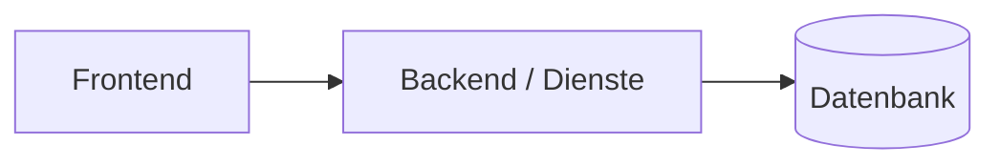
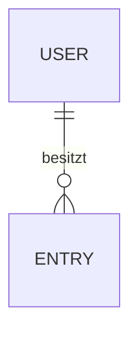

# Ist-Analyse: <Name>

> Erstellt im Modus „Bestehende App“ (B1). Nur lesend erstellt – am Code wurde nichts verändert.
> Analysierter Stand: Branch/Commit `…` · Datum JJJJ-MM-TT

## Zusammenfassung

- **Gesamteindruck (2–3 Sätze, ehrlich):** …
- **Befunde:** kritisch … · hoch … · mittel … · niedrig …
- **Risikostufe:** 1 / 2 / 3 – Begründung
- **Nicht prüfbar:** … (z. B. Einstellungen im Dashboard des Anbieters)

## 1. Überblick

| Punkt | Ist |
|---|---|
| Sprache / Framework | … |
| Wichtige Abhängigkeiten (Version) | … |
| Start / Build / Test | … |
| Hosting / Deployment | … |
| CI | … |

## 2. Funktionen & Screens

| ID | Funktion | Status | Fundstelle |
|---|---|---|---|
| F-01 | … | fertig / halb fertig / kaputt / unklar | `src/…` |

| ID | Screen / Route | Zweck | Fundstelle |
|---|---|---|---|
| S01 | … | … | … |

## 3. Daten

| Objekt.Feld | Klasse | Bemerkung |
|---|---|---|

Externe Dienste und Datenflüsse: …

## 4. Sicherheit

| Prüfpunkt | Ist | Bewertung | Befund |
|---|---|---|---|
| Secrets im Code / Client-Variablen | … | ✅ / ⚠️ / ❌ / ❓ nicht prüfbar | BF-… |
| Zugriffskontrolle / Besitzprüfung | … | … | … |
| Datenbankregeln (RLS / Rules) | … | … | … |
| Mass Assignment | … | … | … |
| Login / Passwort / Reset | … | … | … |
| Rate Limiting | … | … | … |
| Eingabevalidierung / XSS / SQL | … | … | … |
| Header / CORS / HTTPS | … | … | … |
| Abhängigkeiten | … | … | … |
| Logging sensibler Daten | … | … | … |

## 5. Qualität & Betrieb

| Punkt | Ist | Befund |
|---|---|---|
| Tests | … | … |
| Fehlerbehandlung | … | … |
| Monitoring / Backups | … | … |
| Struktur (nur wo sie Änderungen behindert) | … | … |

## 6. Recht (soweit im Code erkennbar)

| Punkt | Vorhanden? | Befund |
|---|---|---|
| Impressum / Datenschutzerklärung | … | … |
| Einwilligung Tracking | … | … |
| Konto-Löschung / Datenexport | … | … |

## Befunde

| ID | Schweregrad | Bereich | Fundstelle | Beschreibung | Sicherheit der Aussage | Empfehlung |
|---|---|---|---|---|---|---|
| BF-01 | kritisch | Sicherheit | `src/lib/api.ts:12` | Geheimer Schlüssel im Frontend (Wert maskiert: `sk_live_****`) | sicher | Schlüssel widerrufen, neu erzeugen, Aufruf ins Backend verlagern |
